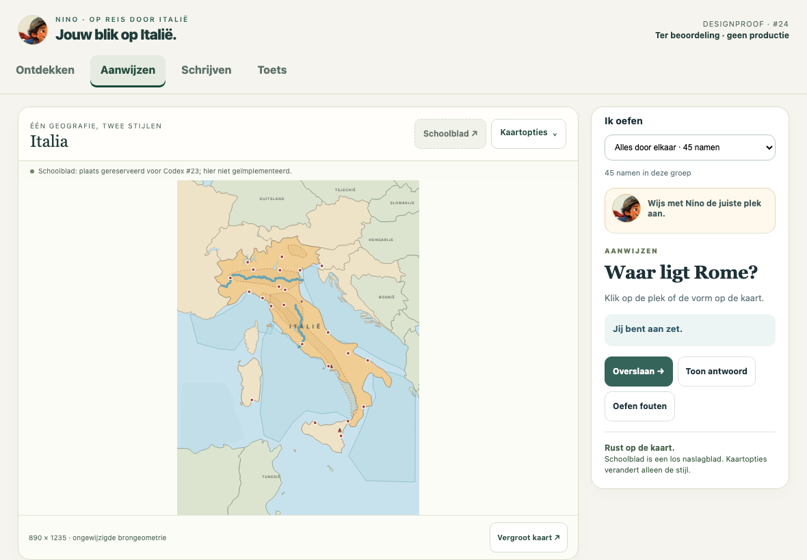
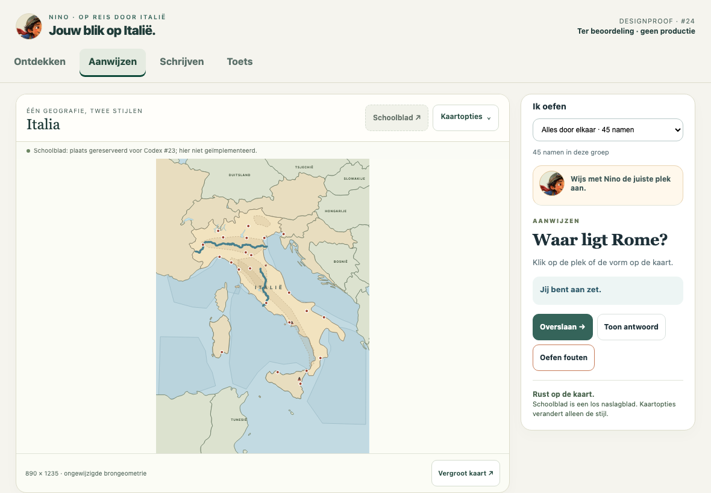
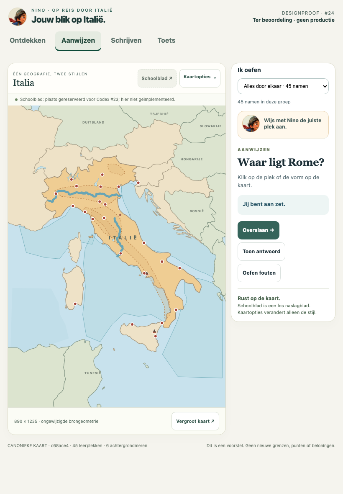
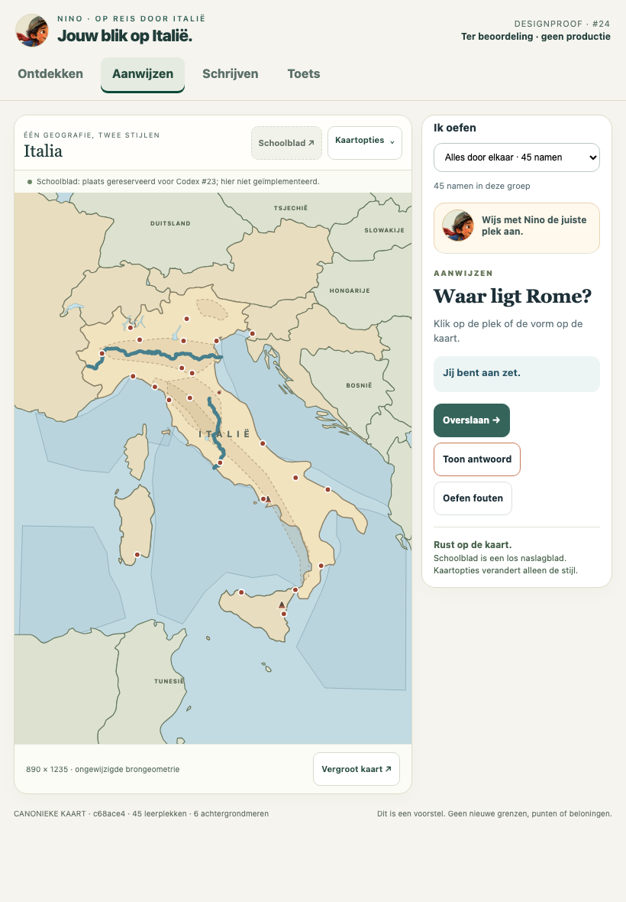
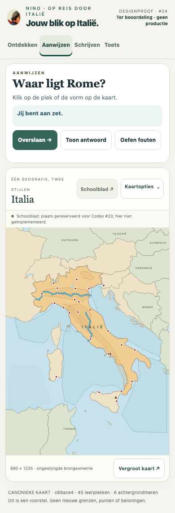
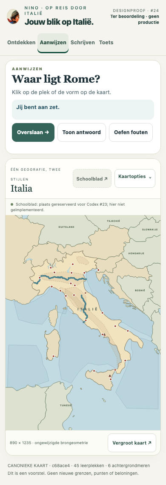
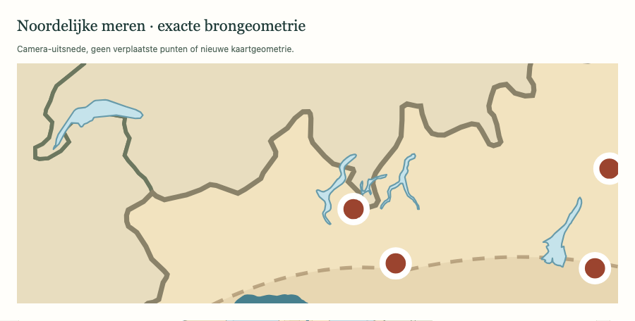
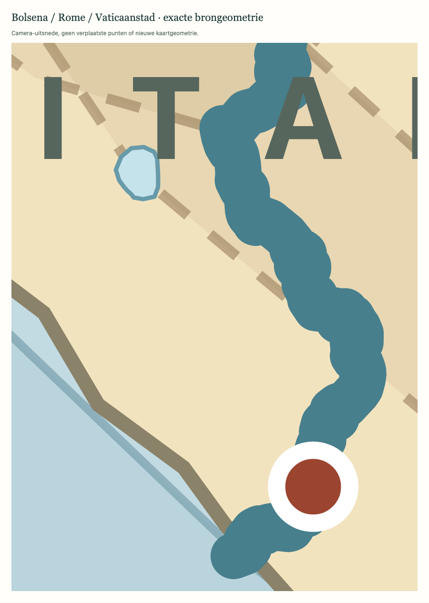

# Eén Italië. Twee manieren van kijken.

**Issue #24 · design/technical proof · recommendation: GO for owner visual approval.**

This is a docs-only proposal, not a production theme switch. Everything here is based on **PR #17 at `c68ace4e44a6e797f536ec1a8d6b517d29167320`**. Schoolkaart retains the exact existing digital map paint. Ontdekkingskaart changes only presentation over that same geography. Codex's schoolblad work and the owner's artwork are untouched.

## Open / inspect

- **[Interactive offline proof](proof.html)** — download and open in a browser, or serve the repository locally. The GitHub file viewer is source, not a deployed app.
- **[Implementation contract](IMPLEMENTATION_CONTRACT.md)** — preference policy, layer/hit constraints, accessibility/print fallback and performance budget.
- **[Proposed CSS token export](tokens.css)** and [executable proof stylesheet](theme.css).
- **[Browser evidence](evidence/browser-results.json)** — all 45 IDs, 27 source/screen anchor positions, all target bounds and exact six lake hashes for each viewport.
- **[Source/size/contrast audit](evidence/source-audit.json)** — protected files unchanged and original inline scripts retained byte-for-byte.

The proof wraps the real source app and runs its real SVG/quiz handlers; this is not image-generated geography, a hand-traced coastline, or a screenshot used as an interactive map. The extra shell is a design context, not a competing schoolblad implementation or complete replacement app.

## Same case, identical frame

Both styles below show the **same unanswered Rome point question**, same 890×1235 source frame, same screen-space matrix within each viewport and no pre-answer highlighted target or Learn names. The side chrome is identical for the pair. Other images show the same Rome writing attention state and a real incorrect answer submitted through the existing app's Check button.

### iPad landscape · 1180×820

| Schoolkaart — unchanged map paint | Ontdekkingskaart — quiet Italian editorial palette |
|---|---|
|  |  |

### iPad portrait · 820×1180

| Schoolkaart | Ontdekkingskaart |
|---|---|
|  |  |

### Phone · 390×844

The question remains above a full-width map. Normal vertical scrolling is intentional; the full portrait frame is not shrunk to a tiny mini-map. Both actual viewport screenshots and full-page evidence are provided. Four mode controls fit on one row. The main map and utility buttons are not horizontally clipped.

| Schoolkaart — full page | Ontdekkingskaart — full page |
|---|---|
|  |  |

## Utilities, attention and neutral overlap

- **[Kaartopties](evidence/ipad-landscape-options.png)** contains exactly **Schoolkaart / Ontdekkingskaart**. Schoolblad is a separate disabled placement reservation, clearly labelled as Codex #23's responsibility. Zoom has its own control. No photographed worksheet is offered as a third style.
- **[Writing attention](evidence/ipad-portrait-discovery-attention.png)** uses the existing orange marker and real writing input; no renamed/relocated target.
- **[Graded wrong state](evidence/ipad-portrait-discovery-graded.png)** comes from a real incorrect answer, not fabricated grading.
- **[Neutral Rome/Vatican picker](evidence/neutral-picker-discovery.png)** shows numbered choices, no answer names. Keyboard activation and an actual touch at the Rome point both open the canonical picker.
- **[Discovery Learn context](evidence/ipad-portrait-discovery-learn.png)** allows the subtle paper/water material; graded practice/test context removes textures/gradients/compass even if the learner explicitly keeps Discovery selected.

## Lakes and microstates — source-derived camera crops

These are camera crops derived from the existing source path bounds and point anchors, not a new projection, boundary or inset approximation. They are visual evidence, not extra labels or hints added to a test.

| Same northern lakes | Same Lazio frame: Bolsena, Rome and Vatican |
|---|---|
|  |  |

School counterparts: [northern lakes](evidence/northern-lakes-school.png), [Lazio](evidence/lazio-school.png). Garda, Maggiore, Como's forks, Lugano, Bolsena and Léman/Genève retain exact original path bytes. Rome/Vatican anchors are never visually spread apart on the main map to make selection easier; the existing neutral picker handles proximity.

## What changes / what does not

| Area | Proof proposal | Preserved |
|---|---|---|
| Atmosphere | Cream/olive land, Riviera water, restrained paper/wash in Learn | Every coast, country/island, river and point |
| Controls | Compact two-choice Kaartopties beside reserved Schoolblad | Schoolblad ownership and separate reference semantics |
| Activity defaults | Discovery for Learn/Discover; School for graded activity | Explicit learner choice survives next/mode changes |
| Graded map | Flat palette, no scenic texture/compass | No new answer labels, highlights, scores or hints |
| Learning | No new learning feature | All 45 IDs, schoolcode removal, progression, rewards, schemas, print |

## Comparative scorecard

**Designer judgement, not a measured child study.** Scale 1–5, higher is better. The comparison rates the map surfaces; the surrounding proof shell is held equal.

| Criterion | Current Schoolkaart | Proposed Discovery | Rationale / guardrail |
|---|---:|---:|---|
| Geographic/data fidelity | 5 | 5 | Identical source geometry; measured zero style-induced drift |
| Recall-task restraint | 5 | 5 | School default; explicit Discovery is flat during grading |
| Target/outline legibility | 4 | 4 | Same marks; stronger selected contextual boundary/label colors |
| Italian atmosphere | 2 | 4 | Warm editorial palette and Learn-only wash, no fake scenic geography |
| Material distraction control | 5 | 4 | Tiny paper motif only in Learn; remove entirely for graded/high contrast |
| Offline/performance simplicity | 5 | 4 | No new bitmaps or network; small bounded CSS/UI overhead |
| Expected willingness to explore | 3 | 4 | Hypothesis: stronger place atmosphere; requires child feedback |

Expected benefit is a more inviting Explore context with the familiar Schoolkaart available for retrieval. There is **no evidence yet that the palette improves retention or test scores**. Do not add decorative boats, tourist paths, labels, mountains or landmarks that could be mistaken for geography.

## Verification actually run

Chrome/Chromium **156.0.8078.4**, `file://`, offline browser contexts, touch emulation, reduced motion, native keyboard controls. iPad **1180×820 / 820×1180** and phone **390×844** were rendered by a real browser and captured at those actual viewport dimensions — **not physical iPad Safari**.

- Identical `ITEMS`, `CONTEXT_LAND`, `italy`, `NAME_ANCHORS`, 45 target bounds and six lake paths; exactly 27 point anchors checked.
- Maximum measured School/Discovery screen-position drift: **0 CSS px in every viewport**.
- School normal-state SVG paint compared against the unmodified canonical app: equal.
- Default policy, explicit style retention through next/mode changes, exactly two radio labels, native keyboard open/close/radio selection, focus restoration, no learner-storage writes on style selection.
- No pre-answer Learn names/target highlight/containment lens; neutral numbered overlap picker via keyboard and actual touch; real wrong-answer feedback.
- Entire iPad map frame fits its viewport; utilities remain inside their card with 44px targets; four phone modes fit one row; no horizontal page overflow.
- No-JS static fallback: 45 reference targets and six lake paths remain. Zero external requests / page errors in the scripted runs.
- Original application/engine scripts are embedded byte-identically; protected production files are unchanged. Source verification also checks the proposed size and selected contrast-pair gates.

Reproduce from this worktree (Node 24.15.0+):

```sh
node docs/map-design-proof/generate.mjs
node docs/map-design-proof/verify.mjs
PLAYWRIGHT_MODULE=/absolute/path/to/playwright/index.mjs \
  node docs/map-design-proof/qa.mjs
```

The default Playwright module path is the author's local test installation; pass the environment variable on another machine. No new project dependency is added. No need to run the app build to view this docs proof; the generator reads the pinned Git object and writes only inside this directory.

## Independent integration review

No schoolblad draft PR was present at task start. Per issue #24's fallback, a separate read-only review of **PR #17 / exact `c68ace4`** was dispatched in an isolated disposable checkout, without waiting for #23 or editing its files. Its final findings will be recorded separately in this directory before final handoff. Do not interpret map-style proof checks as a complete integration or external GIS audit.

## Recommendation and remaining approval

**GO — approve or adjust this design direction, then implement only the bounded map-paint/utility slice in a separate production PR.** This is not approval to merge/deploy or an assertion that the production switch exists.

Owner visual approval comes first. Physical iPad Safari/on-screen keyboard, real child feedback and broader assistive-technology/feedback-contrast acceptance remain open. The inherited nine educational schematic zones remain schematic. The disabled Schoolblad reservation is intentionally not functional; Codex owns the actual fold-out reference. No new artwork, GIS datasets, icons, learning IDs, schoolcode tests, rewards, save fields or print changes are part of this PR.
