# Ontwikkeling — van TOPO Italië naar Nino's Grote Reis

Dit is het logboek van TOPO: een tijdlijn van elke versie die ertoe deed, met screenshots op desktop (1440 × 900) en iPad liggend (1180 × 820). De screenshots komen van de echte HTML-file van elke versie, geopend met lege voortgang.

**Stand op 10 november 2026:** Italië V2 is af (v2.0.2). Aan V3 wordt gewerkt op `codex/topo-v3`. Frankrijk is de volgende reis. Let op: `main` staat nog op de leerroute van 28 september. De V2-releases staan op hun eigen branches en tags.

## Tijdlijn

| Datum | Versie | Git | Wat er kwam |
| --- | --- | --- | --- |
| 10 nov 2026 | **V3 · fase A** (in ontwikkeling) | `codex/topo-v3` | Nieuwe shell in violet glas, hoofdstukken links, echte reliëfkaart, renderscènes |
| 8 nov 2026 | **v2.0.2** | tag `v2.0.2` | Instellingen, deelbare toetsuitslag, Mac-launcher |
| 7 nov 2026 | **v2.0.0 · NINO** | tag `v2.0.0` | Kennismaking, Reis/Oefenen/Reisboekje, paspoort, ansichtkaarten, favicon |
| 30 okt 2026 | Computer-RC | tag `topo-nino-computer-approved-artwork-rc-20261030` | Rome/Vaticaan-kiezer met goedgekeurde artwork, offline release candidate |
| 27 okt 2026 | Offline computer | tag `offline-computer-issue-50` | Apennijnen langs de kust (DEM), geteste iPad-levering |
| 24 okt 2026 | Release 1.2 | `integration/topo-release-1-2-nino-lakes` | Nino-artwork van de eigenaar, zes meren uit een echte bron |
| 23 okt 2026 | Release 1.1 | `codex/topo-release-1-1-polish` | Release 1-geografie, drie leerfases, stabiele beloningen |
| 28 sep 2026 | Leerroute | `main` (`7e38160`) | 11 haltes, replay, Gold, Nino als gids, Vespa en pizza's |
| 24 sep 2026 | Basis | `b9129b7` | Herstelde v6: kaart van Italië, 45 objecten, leren en toets |

---

## V3 · fase A — in ontwikkeling (10 nov 2026)

`codex/topo-v3` · preview: `node scripts/build-v3-preview.mjs` → `output/html/TOPO-V3-Reis-Preview.html#bezig`

Nieuwe vormgeving bovenop de V2-app, die zelf ongewijzigd blijft. Het scherm heeft nu een zijbalk (Reis, Oefenen, Toets, Beloningen, Voortgang), hoofdstukken met scènes en een zwevende reliëfkaart. Daarnaast is vastgelegd dat na Italië Frankrijk komt, als apart landpakket.

| Desktop | iPad |
| --- | --- |
| 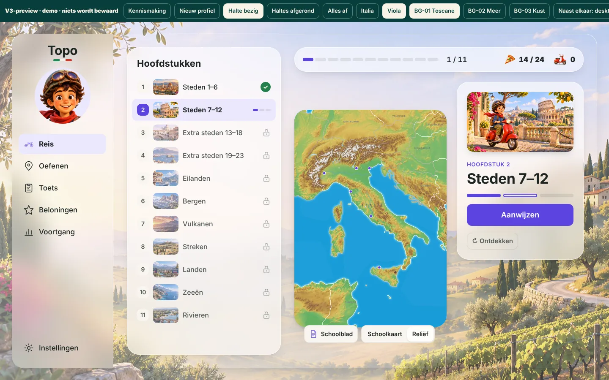 | 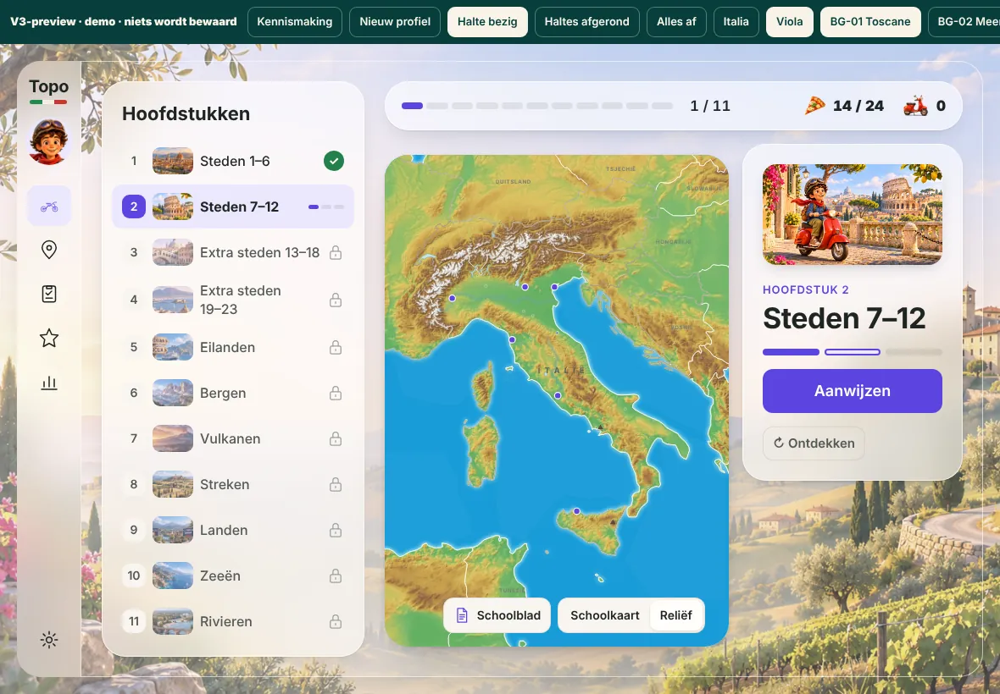 |

## v2.0.2 (8 nov 2026)

Tag `v2.0.2`. Onderhoud van NINO 2: een instellingenscherm met de resetknoppen bij elkaar, een toetsuitslag die je kunt delen, en een native launcher voor de Mac.

| Desktop | iPad |
| --- | --- |
| 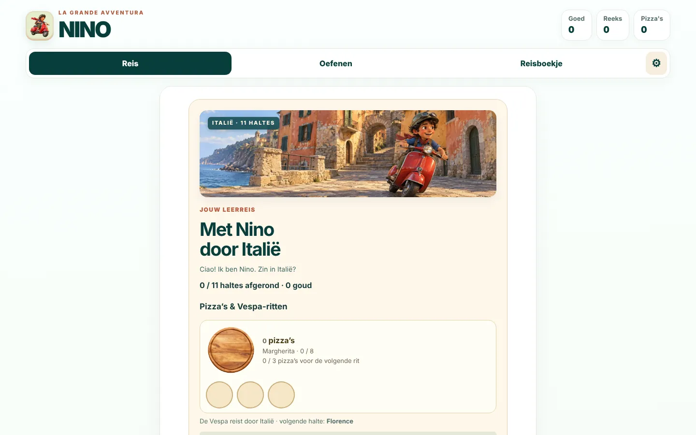 | 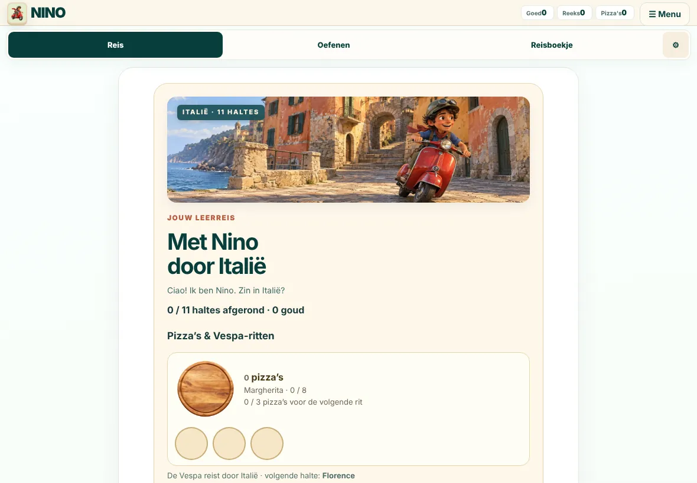 |

## v2.0.0 · NINO (7 nov 2026)

Tag `v2.0.0`. TOPO Italië wordt NINO, "La Grande Avventura". Nieuw zijn de kennismaking (naam en lievelingspizza), de tabs Reis, Oefenen en Reisboekje, het reispaspoort, ansichtkaarten met achterkant en één pizzameter. De screenshot toont de kennismaking bij het eerste bezoek.

| Desktop | iPad |
| --- | --- |
| 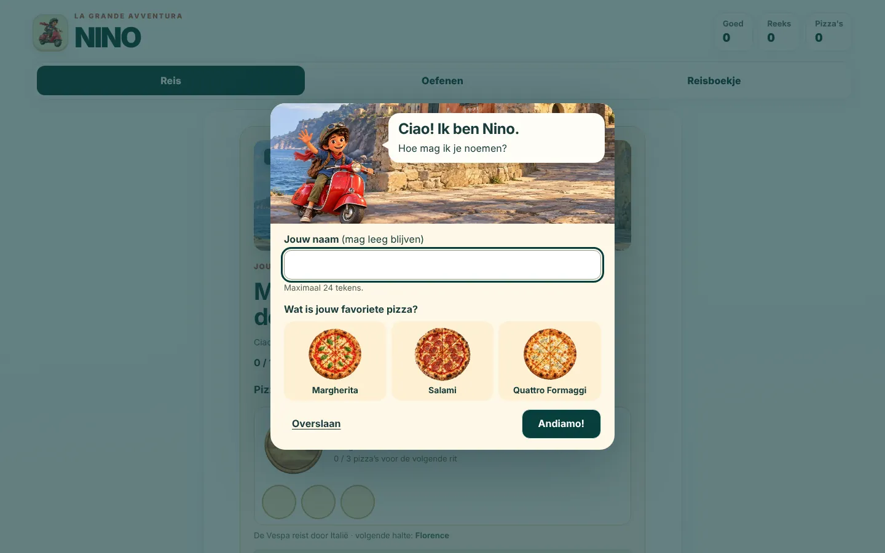 | 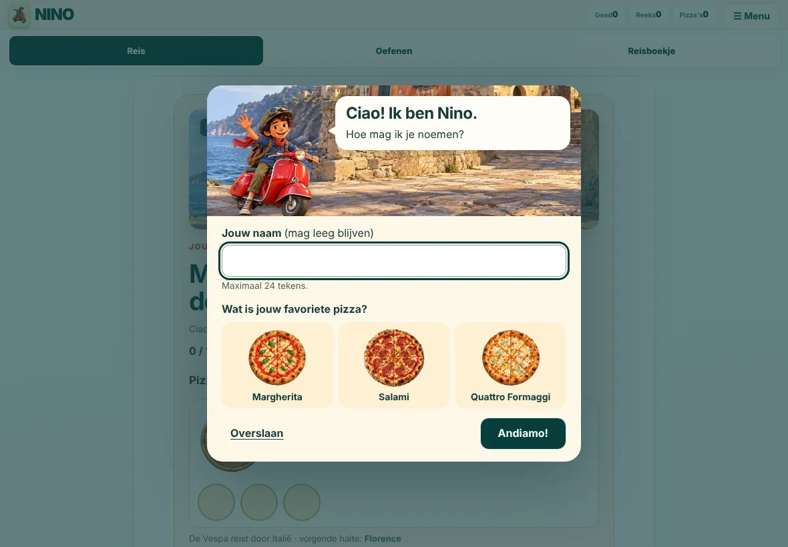 |

## Computer-RC (30 okt 2026)

Tag `topo-nino-computer-approved-artwork-rc-20261030`. Een offline release candidate voor de computer. De kiezer voor Rome en Vaticaanstad gebruikt de goedgekeurde artwork, en op de kaart zijn de keuzes beter van elkaar te onderscheiden. Een paar dagen eerder (27 okt, tag `offline-computer-issue-50`) liepen de Apennijnen al langs de kust, op basis van hoogtedata, en was de iPad-levering getest.

| Desktop | iPad |
| --- | --- |
| 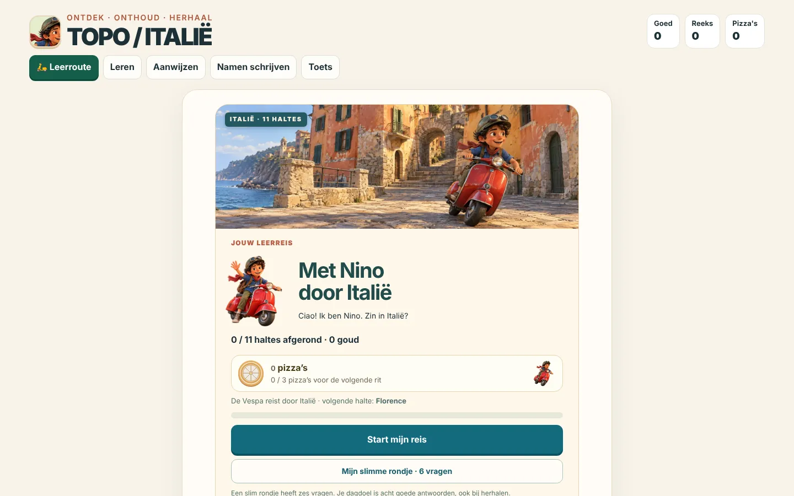 | 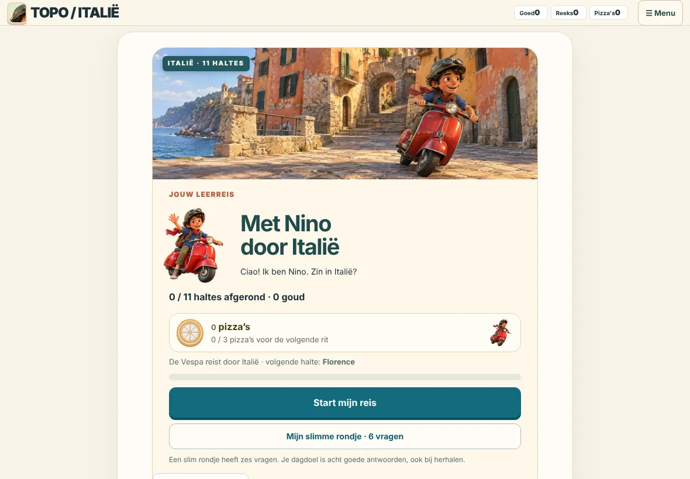 |

## Release 1.2 (24 okt 2026)

`integration/topo-release-1-2-nino-lakes`. De Nino-artwork van de eigenaar zit in de app, en er is een kaartlaag met zes Italiaanse en Alpenmeren uit een echte bron.

| Desktop | iPad |
| --- | --- |
|  | 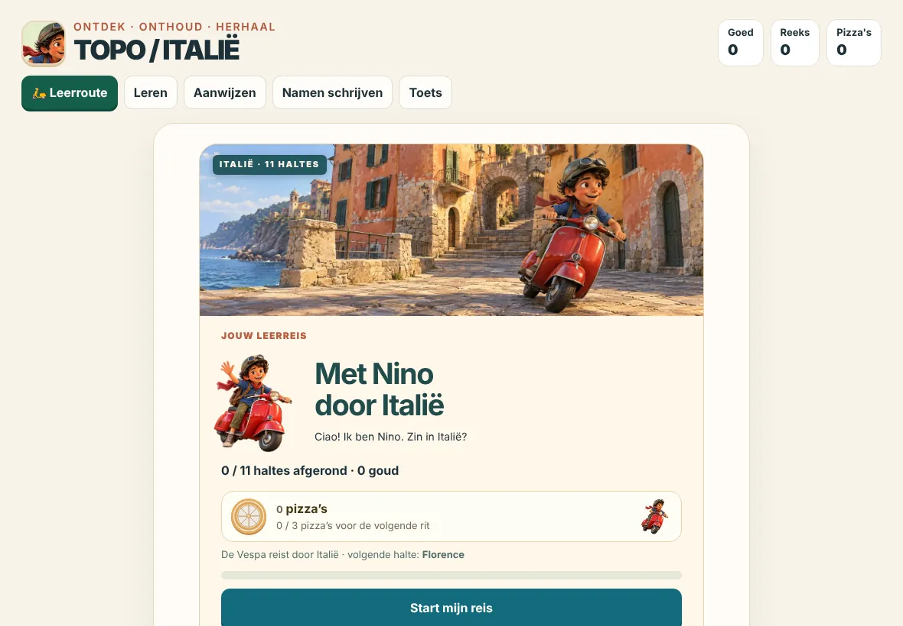 |

## Release 1.1 (23 okt 2026)

`codex/topo-release-1-1-polish`. Release 1 voegt de geografie, de drie leerfases en stabiele beloningen samen. Ook kreeg de leerroute een opknapbeurt, en worden kapotte back-ups van de route nu geweigerd.

| Desktop | iPad |
| --- | --- |
| 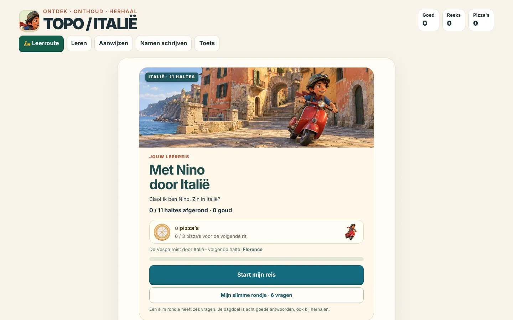 | 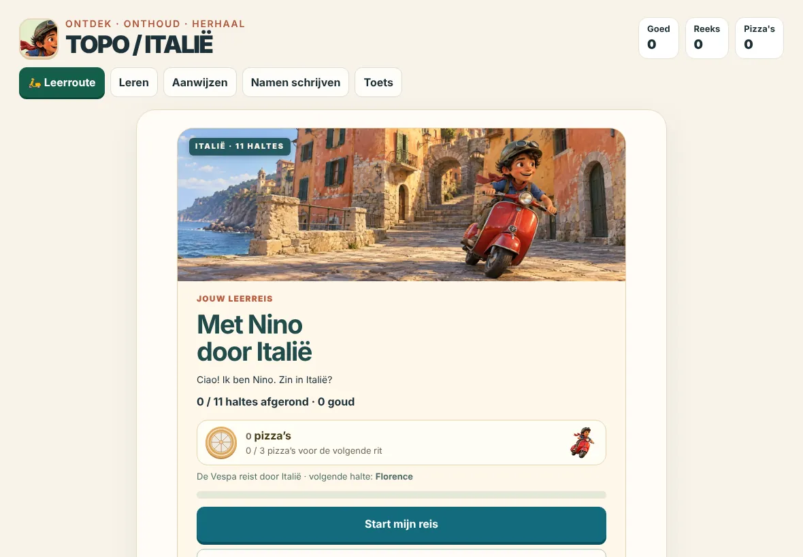 |

## Leerroute (28 sep 2026)

`main` · `7e38160`. De begeleide leerroute: 11 haltes van het schoolblad, elk met Ontdekken → Aanwijzen → Namen schrijven → Schoolcodes. Je kunt fases herhalen, er is een Gold-uitdaging, en Nino rijdt op de Vespa mee met de pizza-voortgang.

| Desktop | iPad |
| --- | --- |
| 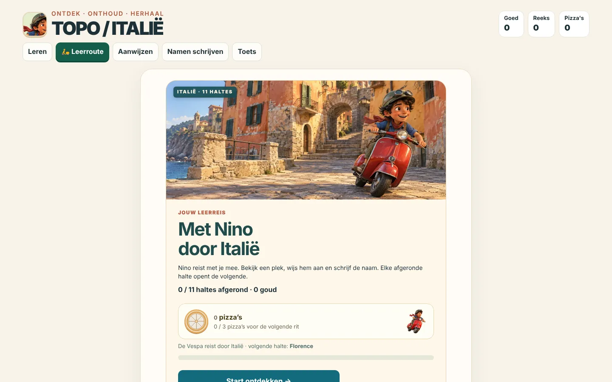 | 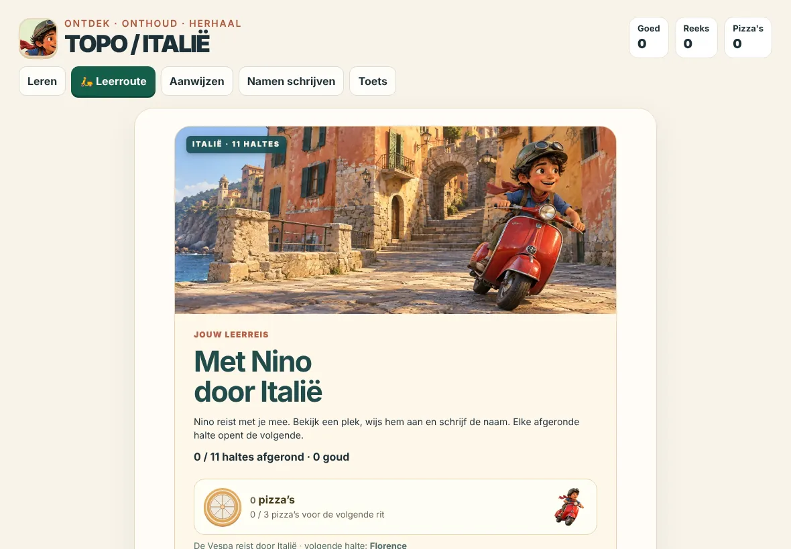 |

## Basis (24 sep 2026)

`b9129b7`. De herstelde v6-versie als startpunt: een interactieve kaart van Italië met 45 objecten, leren in groepen, aanwijzen, namen schrijven en een toets.

| Desktop | iPad |
| --- | --- |
| 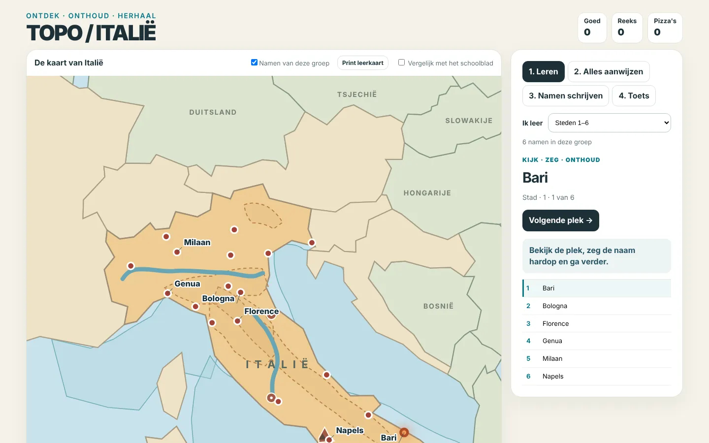 | 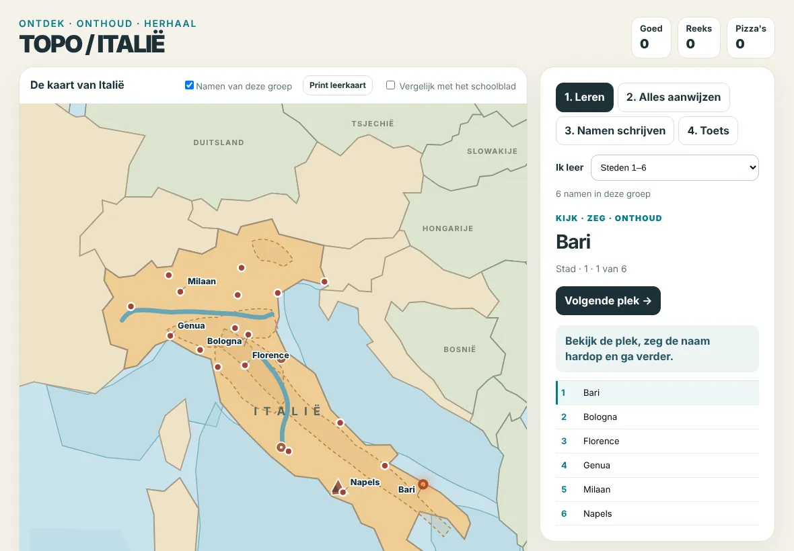 |

---

## Een nieuwe versie toevoegen

Doe dit bij elke tag, en bij elke mijlpaal die je wilt bewaren.

1. Pak de HTML van die versie:
   `git show <tag>:index.html > /tmp/topo.html` (bij V3: bouw eerst de preview).
2. Maak de screenshots:
   `python3 scripts/capture-screens.py /tmp/topo.html docs/ontwikkeling/screens/<nr>-<naam>`
   Kennismaking overslaan: voeg `--set=topo-nino-intro-v1=done` toe.
   Eenmalig nodig: `pip install playwright pillow && playwright install chromium`.
3. Zet een regel bovenaan de tijdlijn, plus een sectie met de twee screenshots, nieuwste eerst.

Gebruik voor nieuwe landen dezelfde vorm. De eerste Frankrijk-versie komt bovenaan als "Frankrijk · eerste reis".
