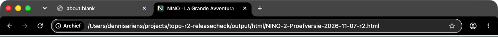

# NINO 2.0 — laatste gerichte r2-releasecheck

## PASS — uitsluitend de drie gevraagde controles

**Geteste commit:** `bb27e617e0525c9821592525071ecd585c65e6e3`.
Vooraf en na de browseruitvoering gecontroleerd: dit was nog de actuele PR71-head. Geen nieuwere kandidaat stilzwijgend getest.

**Geopende gewone offline HTML:** `output/html/NINO-2-Proefversie-2026-11-07-r2.html`.
**Bytes:**41.436.767.
**SHA256:** `e5265ae7118861b98be61b2cdb4bfdd9509a4ea1e864111ac6d52af410093ba0`.

De eigenaar heeft de UX van ronde2 goedgekeurd. Deze review heropent die ontwerpkeuzes niet. Geen brede teststraat opnieuw uitgevoerd: er is in de gerichte checks geen verder reikende regressie gevonden. Dit PASS is geen merge-/deploy-/releasepublicatiebesluit.

## 1. Chrome — F2: profiel bewaren én annuleren

Chrome **157.0.8103.38**, offline file://, verse disposable context per afsluitroute,1180×820.

- Boek geopend; controle vooraf bevestigt dat Pijl-rechts bladert en Pijl-links terugkeert naar het omslag.
- **Pas mijn boekje aan**, naam ingevuld, **Bewaar mijn boekje**: focus blijft op een verbonden knop binnen `travelBook`. Meteen **Pijl-rechts** gaat van **1–2/8 →3–4/8**, zonder click of Tab tussen sluiten en toetsenbordactie.
- Hetzelfde met **Annuleren**: direct **1–2/8 →3–4/8**; focus is eveneens binnen het boek.
- Vraag/modus/voortgang en de exacte opgeslagen voortgang blijven gelijk. De profielnaam mag door Bewaar uiteraard cosmetisch veranderen; er wordt geen voortgang toegekend.

**F2 gesloten voor deze SHA.** [Machinebewijs](chrome-f2.json), [Bewaar](chrome-F2-save-direct-arrow.png), [Annuleren](chrome-F2-cancel-direct-arrow.png).

## 2. WebKit — korte offline speelronde

WebKit **27.2** met overeenkomende Playwright1.64.0/browserbuild2370, gewone HTML via **file://**, netwerk uit, verse context,1180×820. De ontwerppreview is nergens gebruikt.

### Vanaf leeg profiel — werkelijk gespeeld

**Overslaan → Reis → Verder → Start meteen**. De zes Discover-plekken via de gewone knoppen bekeken; vervolgens gestart met Aanwijzen. Tijdens deze reisles bleef **Reis** actief.

Een werkelijk correct pointerantwoord op **Napels**, met echte muis/neutral-chooser waar nodig:

| | Voor | Na |
|---|---:|---:|
| Goede antwoorden |0|1|
| Pizzapunten |0|1|
| Pizza's |0|0|
| Ritten |0|0|

De zichtbare meter toont **1 van8 punten voor Margherita**. **Reisboekje** geopend en gesloten: dezelfde vraag/modus/antwoordstatus, voortgang en opgeslagen bytes blijven behouden; de actieve tab blijft Reis. [Beeld](webkit-fresh-real-answer-meter.png), [boek](webkit-fresh-book.png).

### Daarna de PR-demosave — prerequisiet, geen natuurlijke23-antwoordenroute

Via de echte **backup-fileinput** en bevestiging geïmporteerd:
`output/demo/NINO-2-DEMO-vlak-voor-derde-pizza.json`, SHA256
`dfe9f46d2b8711ab65aaaa38d1194296ea1d52989d4661e37c3e459e0ee57b6c`.

**Uit de demo:** profiel DEMO-save,23 goede antwoorden,2 pizza's,7/8 punten,0 ritten; halte1 staat vóór het laatste schrijfantwoord **Bologna**. Deze import vervangt de eerdere lokale testvoortgang; die verse eerste answer wordt niet bij de demo opgeteld.

**Werkelijk daarna door Hermes uitgevoerd:** één correct getypt antwoord **Bologna** met Controleer. Daardoor: **24 goed,3 pizza's,0 punten,1 rit**. De doos toont **Start de Vespa-rit**. Die knop echt aangeklikt en de normale-motionfasen waargenomen:

**depart → ride → arrived**, met **Aangekomen in Florence!**.

**Verder** op de aankomst sluit de rit; dezelfde lesvraag `city-2` staat weer zichtbaar in de quiz, modus route en actieve tab **Reis**. De ritweergave/terugkeer kent geen extra beloning toe:24/3/0/1 blijft gelijk.

[WebKit-machinebewijs](webkit-play.json), [demo vóór antwoord](webkit-DEMO-before-real-answer.png), [derde doos](webkit-real-answer-third-box.png), [vertrek](webkit-ride-depart.png), [onderweg](webkit-ride-ride.png), [aankomst](webkit-ride-arrived.png), [terug in les](webkit-return-to-lesson.png).

Niet claimen dat23 eerdere antwoorden, de twee voorafgaande pizza's of alle elf hoofdstukken door Hermes zijn uitgespeeld. Alleen de verse pointeranswer en de extra demo-schrijfanswer waren eigen echte antwoorden.

## 3. Chrome — favicon op ware grootte

In een **nieuw gewoon headed Chrome-tabblad**, met een eigen vers tijdelijk browserprofiel en de checksum-gecontroleerde file://-HTML, is de **crèmekleurige N op donkergroen** daadwerkelijk zichtbaar. Geen bestaande persoonlijke browserprofielen/tabs gebruikt.

Native venstercapture **1180×880, schaal1.0**. De tabbalkuitsnede is de bovenste1180×90 pixels zonder resampling; het volledige origineel is ook bewaard. Dit is geen screenshot van alleen de webviewport en geen nagetekende browser-UI. Zelf visueel bekeken op oorspronkelijke schaal.

[Volledig oorspronkelijk Chrome-venster](chrome-native-tabbar-window.png), [native capturemetadata](native-capture-metadata.txt), [browsercontrole](favicon.json). Beide data:image/png-iconen zijn daarnaast echt gedecodeerd als16×16 en32×32, zonder extern verzoek. De visuele tabbalkcontrole betreft1×; native Retina/OS-cachevarianten worden niet meegecertificeerd.

De terminal-helper had aanvankelijk geen Screen Recording-recht. Na expliciete toestemming van de gebruiker is de officiële CuaDriver-permissionflow uitgevoerd en heeft die tool de native capture gemaakt. Geen toestemming automatisch aangeklikt, geen andermans venster vastgelegd. Een eerste Swift-argument-/capturehulpfout betrof alleen de bewijsopname, niet de app; de uiteindelijke PNG en driveruitslag zijn gecontroleerd.

## Scope, reproduceren en niet uitgevoerd

Eigen gerichte driver: [hermes-nino-r2-targeted.mjs](drivers/hermes-nino-r2-targeted.mjs), met aparte `chrome-f2`, `webkit-play` en `favicon`-fasen. Absolute lokale checkout-/SDK-/scratchpaden zijn expliciet; pas die aan op een andere host. [Windowmetadata-helper](drivers/hermes-r2-window-list.swift), [verliesloze native pixelcrop](drivers/hermes-r2-crop.swift). Elke fase controleert de geopende HTML-hash zelf. Playwright gebruikt verse contexts, echte knoppen/toetsen/muis en uitsluitend readonly state-inspectie plus camerascrollen; behalve de expliciete PR-demosave is geen game state geïnjecteerd.

Alle drie uiteindelijke fasen slagen: **0 onverwachte JS-/consolefouten,0 externe requests** tijdens de gemeten offline pages.

**NOT TESTED / niet opnieuw uitgevoerd:** native Safari, fysieke iPad, OS-schermtoetsenbord/IME, VoiceOver, werkelijk printen, Retina-favicon/andere OS-iconcaches; brede build/lint/all45/all11/Gold-/opslagregressies en volledige UX-/artworkreview niet opnieuw uitgevoerd, conform deze beperkte opdracht. WebKit op de Mac is geen native Safari- of fysieke iPad-goedkeuring. Reduced-motion en Overslaan van de rit zijn in deze laatste check niet opnieuw getest; de normale ritfasen wel.

**Releasebesluit:** kandidaat laten staan. Geen merge, deploy, releasepublicatie of vervanging van de bestaande download. Alleen de onafhankelijke bewijsdirectory is op een aparte QA-branch toegevoegd; de PR-kandidaat en bronmasters blijven ongewijzigd. De review op PR71 vermeldt de volledige bewijscommit-SHA.
