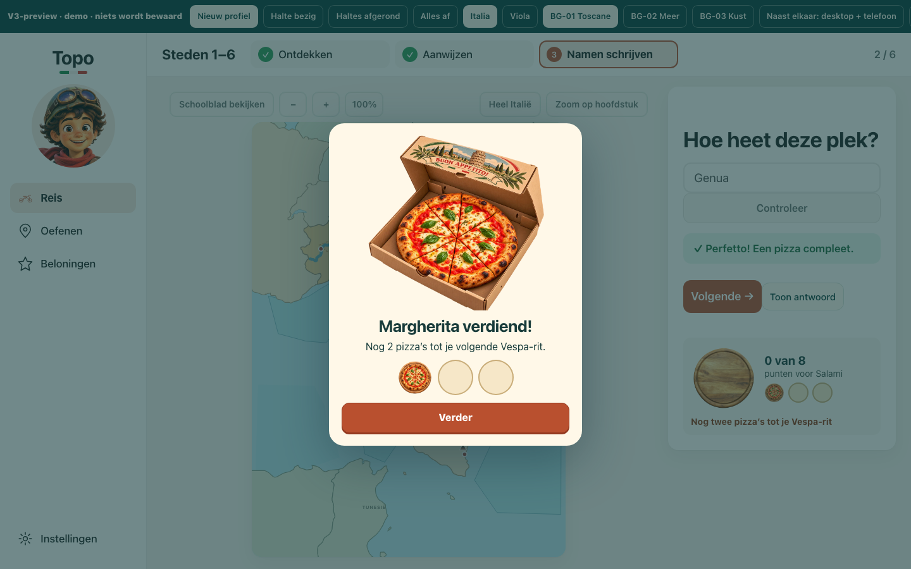
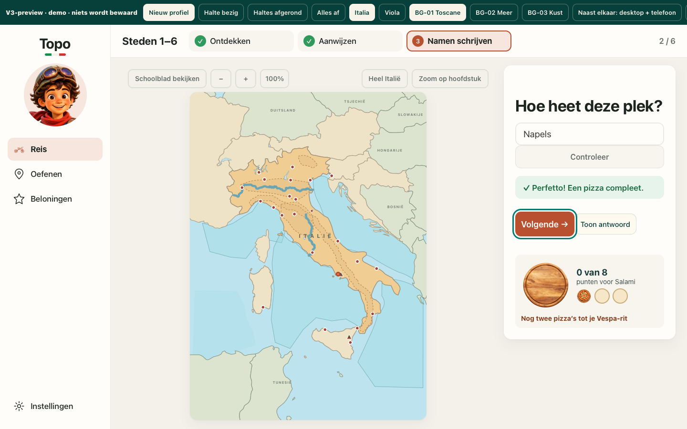

# Hermes — onafhankelijke V3-app-hertest1a42590

## REWORK — één herstelpunt in de keyboard-beloningsovergang

**Geteste pin:** `1a42590de5525bd4d9fb1bcd02bf384e4437b1c2`, `codex/topo-v3`.
**Eigen previewbuild:**50199445 bytes; SHA256 **`23dced34e7d9079cd59195532721f39b1bc6c1f00032ce6c4a41bb4ea619b556`**.
**V2 index.html:** SHA256 **`3aced3c31259011b0af2947c78f71965cb4beb2e88c69d1663e61792b0304f5a`**, ongewijzigd vóór/na build en alle tests.

Beide engines daadwerkelijk uitgevoerd: **Chromium156.0.8078.4**, **WebKit27.2**, Playwright1.64.0, macOS26.2, AppleM4,16GiB. Geen claim dat headless WebKit native Safari of een fysieke iPad is.

| Punt | Chromium | WebKit | Kernbewijs |
|---|---|---|---|
|1. Reis / V3-01..03 |**PASS**|**PASS**|132 unieke hoofdstuk/stijl/formaat/enginegevallen; negatieve naam- en verfcontroles; echte telefoonfocus naar hoofdstuktitel.|
|2. GE01 beat3–7 |**REWORK**|**REWORK**|Echte les/feedback/verdienen/boek/hervatten werken, maar één Enter sluit onbedoeld de zojuist verdiende pizzadialoog bij verminderde beweging.|
|3. Reliëf z8 |**PASS**|**PASS**|4 lagen exact provenance én broncommit;46/46 geometrie + interne transforms; decoratie zonder doelen; aan/uit echt bediend.|
|4. Beloningen / V2-boek |**PASS**|**PASS**|4 demostanden plus echt verdiende toestand tegen werkelijk doorgebladerd V2-boek; zelfde element; focus/terugweg;0 opslagwrites.|
|5. Runtime-assets |**PASS**|**PASS**|23 exportbestanden exact art05ab1d0/manifest;17 daadwerkelijk ingebed; daadwerkelijke DOM-consumenten gehasht in beide engines.|
|6. file:// laden/geheugen/offline |**PASS — Mac-scope**|**PASS — Mac-scope**|6 laadmetingen, aanvullende OS-geheugenmeting;0 externe apprequests/console-errors. Geheugenbeslag substantieel; geen iPad-acceptatie.|

[Machineoverzicht](SUMMARY.json) · [parentprobes punten3/5/6 en build](PARENT-REPORT.md) · [Reis-detailrapport](reis/REPORT.md) · [les/beloningen-detailrapport](gameplay/RAPPORT.md).

**Echte iPad Safari en VoiceOver: NIET GETEST — eigenaar. Geen merge, deployment of downloadvervanging.**

## Herstelpunt GE01-K01 — Enter activeert onbedoeld Verder

Zelf door de parent opnieuw gereproduceerd in **beide engines**, met positieve muisklikcontrole, op het exact gehashte artifact. Geen antwoord-, beloning- of save-injectie.

### Kortste reproductie
1. Emuleer **verminderde beweging** (`prefers-reduced-motion:reduce`) en open `#nieuw` met nul voortgang.
2. Speel Steden1–6: Ontdekken, zes correcte Aanwijzen-antwoorden, daarna één correct schrijfantwoord.
3. Geef bij de volgende schrijfvraag het correcte antwoord en druk **éénmaal Enter**. Dit is het achtste beloonbare antwoord.

**Verwacht:** één pizza verdiend, statische pizzadoos zichtbaar tot een bewuste vervolgactie.
**Werkelijk:** pizza wordt correct verdiend, maar dezelfde Enter veroorzaakt een klik op de nieuw gefocuste knop **Verder**, waarna `pizzaCelebration` direct sluit. De gebruiker mist het verdiende beloningsmoment. Geen verdwenen of dubbele valuta gevonden.

Controle: dezelfde echte drempel via **Controleer klikken** laat `pizzaCelebration` wel open staan. Claim beperkt tot de daadwerkelijk geteste reduced-motionconditie; geen onbewezen uitspraak dat dit zonder die instelling ook gebeurt, en geen claim dat dit nieuw ten opzichte van V2 is.

Parent eventvolgorde Chromium:
`keydown Enter → answer` → `click → Verder` → `keyup Enter → Verder` → `close → pizzaCelebration`.
WebKit sluit eveneens door de onbedoelde Verder-klik, vóór keyup. Beide eindigen op1 pizza/0 stukjes; verschil is de zichtbaarheid van de dialoog.

[Parent Chromium-ledger](parent-repro/chromium-pizza-probe.json) · [parent WebKit-ledger](parent-repro/webkit-pizza-probe.json) · [byte-identiek heruitgevoerde reproductiedriver](parent-repro/pizza-probe.py). Alleen de `__file__`-outputlocatie verschilt van de reviewerdriver; bronassets en app bleven ongemoeid.

**Volgende actie:** voorkom dat de bevestigingstoets de nieuw geopende beloningsactie óók activeert. Daarna alleen deze Enter/Controleer-overgang gericht hertesten in beide engines met verminderde beweging; geen noodzaak de geaccepteerde geografie/artwork opnieuw te bouwen.

## 1. Reis — PASS, met verklaarde maintained-harnessmeldingen

V3-01: contextnamen zoals ITALIË/DUITSLAND/BOSNIË blijven conform eigenaarbesluit. Geen van de45 leerplek-namen/aliassen in kaartlabels aangetroffen. Negatieve DOM-controle **`B Á R I`** wordt in beide engines als Bari/city-1 gedetecteerd. Injectie alleen in disposable browser-DOM, niet in kandidaat.

V3-02: **132/132 unieke onafhankelijke cases** =11 hoofdstukken ×2 kaartstijlen ×3 formaten ×2 engines. Formaten390×844,320×640,820×1180. Geen geselecteerde kaartverf onder bediening.88 cases hadden geen kaart/bedienings-bboxintersectie;44 tabletgevallen zijn aanvullend met echte geselecteerde RGB-verfdifferentie getest. Layout/CTM/viewBox/scroll eerst6 frames stabiel. Verfcontrole met schakelaar kunstmatig boven Sicilië detecteert1735/1710 pixels; de detector is dus niet vacuüm-groen. [Matrix](reis/matrix.json), [negatieve verfcontrole](reis/paint-negative-control.json).

V3-03:4 echte pointer-/keyboardcases. `H1#v3Title`, tabindex=-1, zichtbaar na hoofdstukselectie; volgende Tab/Option-Tab bereikt de hoofdactie. Geen voorafgaande `focus()` in de testdriver. [Focusbewijs WebKit](reis/independent-webkit/focus-keyboard.png).

**Maintained-script niet mooier voorgesteld:** `qa-v3-reis.py` volledig in beide engines uitgevoerd met alleen launchregel vervangen. Beide exit0, maar het ongewijzigde WebKit-resultaat bevat twee niet-groene checkgroepen: gewone Tab en8 `mapFrameShort`-gevallen. Eigen controles verklaren beide:
- macOS WebKit neemt knoppen standaard via Option-Tab mee; echte Option-Tab/Enter toont correcte appfocus, zonder hostinstelling te veranderen.
- `SVG.scrollIntoView(block:center)` scrollt de telefoonkaart in WebKit buiten beeld. De oorspronkelijke resultaten zijn bewaard. Expliciete centreermeting met dezelfde requiredfeatures en>=80%-contrastcriteria slaagt **24/24**. Geen geografie- of contrasteis verzwakt.

Dit zijn harnessbevindingen, niet genegeerde rode appchecks. [Oorspronkelijk maintained WebKit-resultaat](reis/maintained-webkit/results.json) · [frame-diagnose](reis/frame-diagnostic.json) · [expliciete framechecks](reis/frame-explicit-scroll.json). Bron en artifact hashes na afloop gelijk.

## 2. GE01 — wat naast het herstelpunt slaagt

Onafhankelijk vanaf **`#nieuw`** gespeeld: Ontdekken → Aanwijzen → Namen schrijven, correcte én foute feedback, reparatievragen en afronding via echte UI. Beide engines eindigen op **12 goed,1 pizza+4 stukjes,0 ritten,1 nieuw stempel**. Geen `grade()` aangeroepen om voortgang te maken. De fysieke kaart/overlapkiezer en de invoer zijn via UI bediend.

Het daadwerkelijk verdiende stempel opent het bestaande V2-boek op de juiste spread. [Verdiende stempel](gameplay/independent-webkit/finish-earned-book.png).

Hervatten: vraag-ID, modus, concept **`Rome concept`** en echte keyboardselectie **9–12 backward** blijven identiek na Reis→Ga verder, én na les→Beloningen→boek openen/bladeren/sluiten→Reis→Ga verder. De invoer krijgt niet automatisch focus; dat wordt hier niet als automatische focusherstel-PASS gepresenteerd. De gevraagde selectie/data blijven wel intact.

Een werkelijk gespeelde herhaling voegt geen valuta toe: voor/na4 stukjes/1 pizza/0 ritten. Ook boek/heropenen/Beloningen/terugnavigeren veranderen de voortgang niet.

**Fixtures gescheiden:** maintained `qa-v3-les.py` is geheel opnieuw uitgevoerd in beide engines op5 formaten, alleen launchadaptatie. Alle oorspronkelijke leschecks groen, inclusief echte pizza/Vespa op telling, feedback, stempel/boek en terugweg. Het begint echter op **`#bezig`**:1 pizza+6 stukjes en eerdere hoofdstukvoortgang komen uit de demo. Alleen volgende UI-antwoorden en overgangen zijn daar nieuw verdiend. Geen Codex-/bouwerresultaten als onafhankelijke Hermes-run gepresenteerd.

**Reloadgrens:** preview bewaart voortgang bewust alleen in memory en herstelt bij reload de hash-baseline. Geen persistente anti-replay van een werkelijk verdiende save in dit artifact aangetoond; niet als regressie of als persistentie-PASS verkocht. Same-session replay/heropenen/terugkeren zijn wél uitgevoerd. [Ledgers](gameplay/results.json).

## 3. Reliëf — PASS

Zelfstandige4-laags SHA/bytescontrole tegen provenance en exact broncommit `v3/relief-z8@2a7b0cf`; daadwerkelijke browserdataURI's eveneens gecontroleerd.46/46 geometrische records en interne transforms gelijk aan live kaart. De raster/gloed/basispaden zijn decoratie zonder nieuwe doelen, pointer-events of focusstops. Schoolkaart/Reliëf bediend en decoratielagen correct aan/uit.

**<=2,84SVGpx-kustafwijking is voor V3.0 geaccepteerd en niet heropend.** Geen upstream DEM-rebuild of externe GIS-hercertificering geclaimd. [Metingen](parent/results.json) · [provenancecheck](static/results.json) · [reliëf WebKit](parent/webkit-reis-relief.png).

## 4. Beloningen — PASS

Vier demostanden en de werkelijk verdiende toestand gecontroleerd tegen het **daadwerkelijk met Vorige/Volgende doorgebladerde V2-boek**, niet alleen dezelfde tellerformule herhaald. Het boek wordt eerst teruggebladerd omdat het zijn spread onthoudt.

| Stand | Pizza’s+stukjes | Ritten | Stempels | Goud | Postkaarten |
|---|---|---|---|---|---|
|nieuw fixture|0+0|0|0|0|0|
|bezig fixture|1+6|0|1|0|0|
|afgerond fixture|7+3|2|4|2|0|
|alles fixture|21+0|7|11|11|4|
|nieuw→echt gespeeld|1+4|0|1|0|0|

V3-pizzategel telt huidige stukjes (`4/8`, `Pizza2`), niet het totale bezit; ritmeter volgt pizzas%3. Toegang vanuit Reis én les focust `v3RewardsTitle`. Echte Tab/Enter, WebKit Option-Tab/Enter opent **Open Reisboekje**; hetzelfde `TopoBook.element`. Escape/focusretour naar verbonden boekknop en terugweg naar les slagen.

Canonieke voortgang en volledige preview-opslag voor/na gelijk; **0 setItem-aanroepen** bij elke geteste Beloningen/boekcyclus. [Getoetste tellers/focus/readonly](gameplay/results.json) · [boekknop-focus](gameplay/independent-webkit/earned-book-button-focus.png).

## 5. Assets — PASS

23 fysieke runtime-exportbestanden exact `art/v3-render-assets@05ab1d0808aa20a18b99fea81950a6284539bf03` en manifest, inclusief bytes/maat/alfa.17 ervan worden daadwerkelijk ingebed;6 ongebruikte48px-varianten zijn niet als runtimegebruik geclaimd. Daarnaast daadwerkelijke DOM-bronnen voor achtergronden, portret, tellers,3 stadskoppen/minis en beloningen in beide engines gehasht. Geen master herschreven. [Bestandscontrole](static/results.json) · [DOM-verificatie](parent/dom-assets-and-memory-limits.json).

## 6. Laden/geheugen/offline — PASS binnen Mac-scope, substantieel geheugenbeslag

50.199.445B file://;3 laadsamples per engine. Document-load: Chromium891–904ms, WebKit1126–1648ms. Eerste interactieve marker: Chromium1042–1643ms, WebKit1243–1667ms.

OS Summary Footprint verse extra meetrun: **Chromium1263623056B≈1205MiB**, **WebKit741626992B≈707MiB**. Procesgroep inclusief GPU/netwerk/launchwrapper; geen 'alleen JS-heap'-cijfer. Extra decode/RSS-reeks loopt tot circa2GiB op; geen geheugenlek of langetermijnplateau uit deze korte reeks afgeleid.

**Correctie transparant bewaard:** eerste WebKit-descendant-RSS miste launchd-XPC-processen. Dat ruwe controllercijfer is geen totale WebKitmeting; definitieve onderbouwing gebruikt OS-footprint en launch/close-procesgroeponderzoek. Geen ontbrekende WebKit-heapAPI verzonnen. Hash-/diagnoseallocaties vonden niet vóór de aanvullende geheugensnapshot plaats.

Geen koude OS-schijfcache geclaimd; andere QA kan hostbelasting beïnvloeden; RSS telt sharedpages dubbel en is niet footprint. Geheugenbeslag is een serieus punt voor echte iPad-acceptatie, geen automatische desktop-REWORK zonder afgesproken budget, en geen iPad-PASS.

Alle6 hoofdlaadproeven0 app-page HTTP(S)/WebSocketpogingen,0 page-/console-errors. Eerste context online met uitgaand HTTP onderschept; vervolg offline. Geen externe appresources nodig. [Prestatiestatistiek](parent/summary.json) · [geheugensupplement](parent/memory-supplement.json) · [volledige methode/grenzen](PARENT-REPORT.md).

## Afronding en geldigheidsgrenzen

- Eigen lint/test/build-gate: **exit0**, [volledig log](gates.log). Maintained Reis/les zelfstandig uitgevoerd; volledige oorspronkelijke stijlbeeldsuite gelezen maar niet uitgevoerd. Punten3/5/6 zijn met eigen gerichte probes getest, niet als uitvoering van die hele suite voorgesteld.
- Alle besluiten van9november uit de pin gelezen. Nieuwere head `89404f3491854d3c6004ab541079c39bef8bf0ec` had alleen6 regels DECISIONS; diff bewaard. **Uitgevoerde pin blijft1a42590**, geen stilzwijgende transfer van het oordeel.
- **Fysieke iPad Safari, VoiceOver en OS-IME: NIET GETEST.** Persistente echte-save-reload en langetermijngeheugen niet geclaimd.
- Definitieve deelreviewruns en oorspronkelijke maintained rode checkvelden zijn meegeleverd. Voorlopige `*-attempt*`-diagnostiek blijft lokaal in scratch; niet als definitief bewijs gepubliceerd.
- Alleen bewijs onder deze directory. Kandidaat/manifest/assets/appcode ongewijzigd. Geen merge, release, deployment of bestaande-downloadvervanging.
