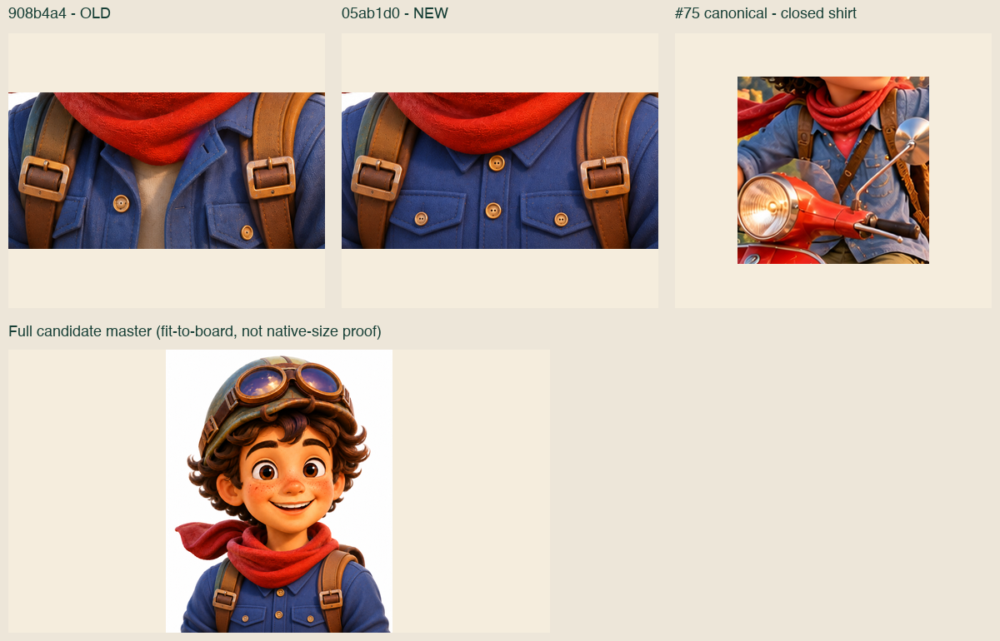
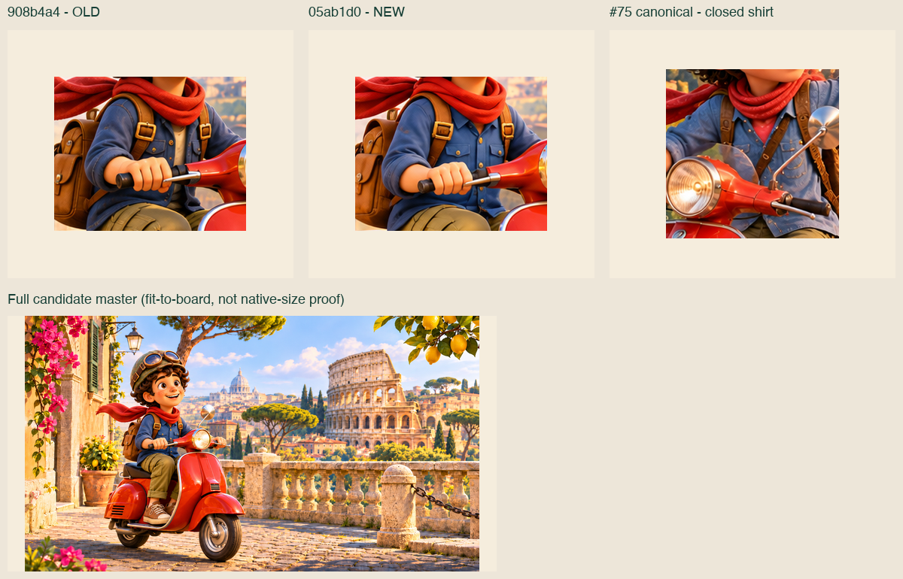
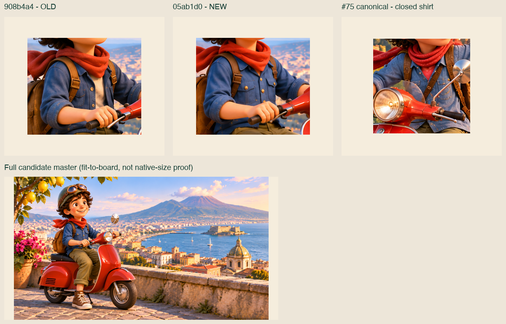

# Hermes — gerichte artwork-hertest05ab1d0

## PASS — drie gewijzigde beelden

**Getest:** `05ab1d0808aa20a18b99fea81950a6284539bf03` op `art/v3-render-assets`.
**Vergelijking:** `908b4a498199ece40a047f19efb2e80fe62812b8`.
**Bewijsbranch:** `qa/v3-art-05ab1d0`; alleen dit bewijs onder `docs/qa/hermes-v3-art-05ab1d0/`. Geen assets gewijzigd of gegenereerd, geen merge.

| Beeld | SHA256/bytes/maat/alfa | Nino-model en shirt | Vespa / miniatuur | Oordeel |
|---|---|---|---|---|
| **NINO-PORTRET** | Alle3 bestanden exact manifest; master/alpha1122×1402, export512×512 | Master: gesloten blauw werkshirt, kraag, knopen en borstzakken; geen wit ondershirt zichtbaar. Gezicht, krullen, groene helm/bril, rode sjaal en leren riemen consistent. | Geen Vespa of landschapsminiatuur bedoeld: N/A. Geaccepteerde hoofd-/schoudercrop en lichte haarrand niet opnieuw afgekeurd. | **PASS** |
| **SCENE-ROMA** | Alle3 bestanden exact manifest; master/kop1672×941, mini480×270 | Voorpand nu gesloten blauw met kraag en knopen; oude witte middenstrook weg. Gezicht, haar, helm/bril, sjaal, rugzak, cargo, omgeslagen pijpen en bruine sneakers blijven herkenbaar canoniek. | Geen zichtbaar logo/tekst op de daadwerkelijke Vespa-export bij native zoom. Nieuwe mini zonder Nino/Vespa-fragment. | **PASS** |
| **SCENE-NAPOLI** | Alle3 bestanden exact manifest; master/kop1672×941, mini480×270 | Gesloten blauw werkshirt, kraag en knopen, zonder wit ondershirt. Omgeslagen broekspijp nu duidelijk zichtbaar. Overige zichtbare modelkenmerken passen bij de referenties. | Geen zichtbaar logo/tekst op daadwerkelijke Vespa-export bij native zoom. Nieuwe mini zonder Nino/Vespa-fragment. | **PASS** |

**Totaal:**3 logische assets,9 unieke fysieke bestanden/manifestregels,0 afwijkingen. [Alle volledige hashes en meetwaarden](file-checks.csv) · [verwacht versus werkelijk](inventory.json) · [machineoordeel](SUMMARY.json).

## Scope en eigenaarbesluiten

De Git-diff bevestigt exact de opgegeven wijzigingsscope:9 beeldbestanden van deze drie assets plus het manifest. Buiten deze drie zijn de manifestinhoud/assetbytes ongewijzigd, afgezien van de vastgelegde BG-statusnotities. Geen brede artwork- of runtime-teststraat herhaald.

De twee benoemde besluiten uit `docs/DECISIONS.md` zijn daadwerkelijk gelezen op **`codex/topo-v3@cdcf30dbf7caef2da5ab989f12b5055bdc250727`**. De artpin bevat die secties nog niet; daarom is de documentatiebron apart gepind en vastgelegd, niet stilzwijgend aan de artcommit toegeschreven. De huidige expliciete eigenaaropdracht bevestigt dezelfde uitzonderingen. [Besluittekst](DECISIONS-excerpt.md) · [provenance](decisions-provenance.json).

Toegepast:
- **BG-01..03:** vaste bronresolutie-uitzondering; niet opnieuw beoordeeld. Visuele kwaliteit boven bestandsgrootte, budgetten in KiB. Eerdere achtergrondbevindingen worden hier niet heropend en ook niet als nieuwe technische PASS voorgesteld.
- **Shirt:** het latere besluit *Nino draagt overal hetzelfde shirt* supersedeert de eerdere toestemming voor variërende snit. Hier dus wél overal gesloten blauw knoopwerkshirt met kraag en zonder wit shirt eronder.
- **Portret:** hoofd en schouders en lichte haarrand op donker zijn geaccepteerd; niet opnieuw als REWORK geteld. Broek, schoenen, volledige rugzak en Vespa zijn buiten de portretuitsnede: N/A, niet ontbrekend of BLOCKED.
- Overige assets, waaronder Venezia en de runtime-iconen, zijn niet opnieuw getest; deze hertest is geen nieuw blanket-oordeel over alle15 assets en geen appintegratie-/releasebesluit.

## Bestandscontrole

Zelfstandig SHA256 en bytegrootte uit originele bytes berekend; pixelmaten en effectieve alfa met Pillow gedecodeerd. Elk van de9 records matcht exact het actuele manifest. [Reproduceerbare audit](audit.py) schrijft alleen naar de aparte bewijs/scratchlocatie, nooit naar bronassets.

| Bestand/rol | Bytes | Pixelmaat |
|---|---:|---|
| Portret master |2114016|1122×1402|
| Portret alpha-master |2451210|1122×1402|
| Portret export |53086|512×512|
| Roma master |2719471|1672×941|
| Roma kop |336364|1672×941|
| Roma mini |34598|480×270|
| Napoli master |2495974|1672×941|
| Napoli kop |275572|1672×941|
| Napoli mini |27984|480×270|

Deze hertest claimt geen pixelidentieke gezichten of één identieke shirttextuur over verschillende poses. De getoetste modelregel is de zichtbare vaste identiteit plus dezelfde gesloten blauwe shirtconstructie zonder witte onderlaag.

## Shirt- en modelbewijs

Hele masters en werkelijke runtime-exports bekeken, daarna native detailuitsnedes. Vergelijkingsplaten tonen oud (`908b4a4`), nieuw (`05ab1d0`) en de canonieke #75-shirtreferentie. De platen zijn **fit-to-board**; de losse `*-shirt-native.png` zijn ongeschaalde broncrops. Beide zijn bewijs, geen nieuwe artworkbewerking.

De #75-bron `assets/nino/scenes/topo-steden-firenze.png` komt exact uit `8a704cb23da97baf7197635df7fa12f06b864a24`. Canonieke `nino-guide.webp` is hergebruikt met bytecontrole tegen zijn broncommit. [Referentieherkomst en hashes](reference-manifest.json) · [crop-coördinaten](crop-manifest.json). Niet alleen manifestnotities of bouwersresultaten als bewijs gebruikt.

### Portret — PASS

[Native shirtcrop](NINO-PORTRET-shirt-native.png) · [werkelijke512-export op licht/donker](portrait-runtime-light-dark.png).

Het shirt wordt in de volledige master beoordeeld: de512-export laat voornamelijk het geaccepteerde hoofd/sjaal/schouderrand zien. Geen ongeziene borstpartij of onderlichaam als zichtbaar gecertificeerd.

### Roma — PASS

[Native shirtcrop](SCENE-ROMA-shirt-native.png) · [daadwerkelijke runtime-kop](SCENE-ROMA-export_kop.webp) · [mini](SCENE-ROMA-export_mini.webp).

### Napoli — PASS

[Native shirtcrop](SCENE-NAPOLI-shirt-native.png) · [daadwerkelijke runtime-kop](SCENE-NAPOLI-export_kop.webp) · [mini](SCENE-NAPOLI-export_mini.webp).

## Vespa-details en miniaturen

[Native Roma-Vespa](SCENE-ROMA-vespa-native.png) · [native Napoli-Vespa](SCENE-NAPOLI-vespa-native.png) · [coördinaten en bronrollen](vespa-crops.json).

Voertuigfront, stuur/koplamp, spatbord en achterzijpaneel zichtbaar gecontroleerd in de daadwerkelijke nieuwe WebP-koppen. Geen leesbare tekst, merkwoord of merkschildje aangetroffen. Roma's kleine rooster en beide mechanische zijventilaties zijn geen logo. Napoli's kleine ronde glans/contour op het front is geen aangetoond merk. Dit is visuele artwork-QA, geen juridische merkclearance.

De twee actuele480×270-miniaturen zijn volledig afzonderlijk bekeken, inclusief alle randen. Roma toont Colosseum/landschap; Napoli baai/Vesuvius/architectuur. Geen Nino, helm, sjaal, hand, rugzak of Vespa-rest zichtbaar. Niet simpelweg de vorige mini-PASS overgenomen.

## Afronding

**PASS voor elk van de drie opnieuw beoordeelde beelden.** De shirtbevindingen uit908b4a4 zijn voor deze gewijzigde assets opgelost onder de huidige modelregel. Eigenaar-uitzonderingen blijven expliciet toegepast. Geen bronasset, manifeststatus, runtimecode of eerdere QA gewijzigd; geen merge, deployment of runtime-integratietest. Volgende stap is een eigenaar-/integratiebesluit, niet een automatische releaseactie.
