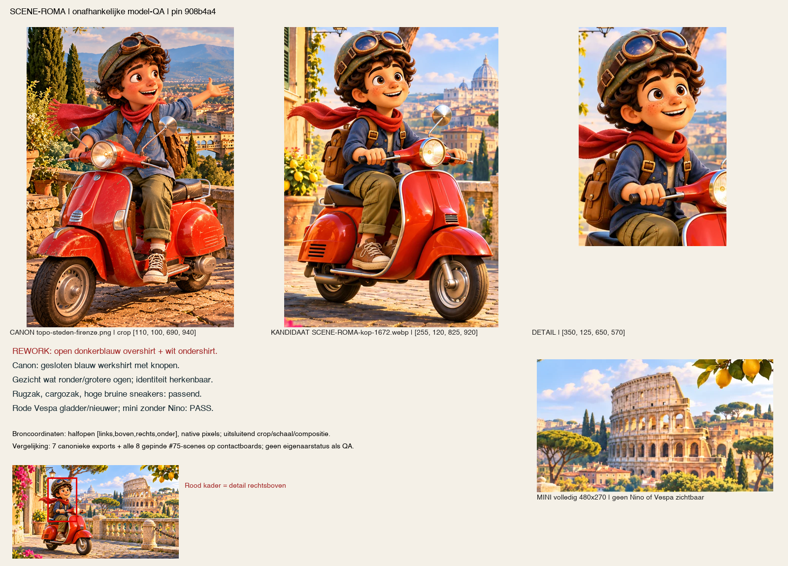

# Onafhankelijke artwork-QA — TOPO V3 renderassets

## REWORK — exacte kandidaat908b4a4

**Geteste commit:** `908b4a498199ece40a047f19efb2e80fe62812b8`, branch `art/v3-render-assets`. Geen assets gewijzigd of opnieuw gegenereerd. Bewijs uitsluitend in `docs/qa/hermes-v3-art-908b4a4/` op `qa/v3-art-908b4a4`.

**Integriteit PASS:**15 logische assets,40 manifestregels,39 unieke bestanden; elke SHA256, bytegrootte, pixelmaat en effectieve transparantie exact gelijk aan het manifest. IC-vespa en VE-01 delen één master; daarom niet als40 unieke bestanden tellen.

**Niet hetzelfde als volledige artworkacceptatie:** drie Nino-beelden hebben outfit-/portretafwijkingen. De drie achtergrondmasters voldoen niet aan de gevraagde bronresolutie. BG-03 heeft bovendien een budgeteenheid-grensgeval. De overige negen assets slagen binnen hun hieronder begrensde rol. Geen BLOCKED wegens ontbrekende bronnen: alle vereiste referenties zijn beschikbaar.

## Per asset

| Asset | Bytes/maat/alfa versus manifest | Model / inhoud |24/48px / DPR2 | Totaal |
|---|---|---|---|---|
| BG-01 |PASS;433106B export|Rustig midden, details aan randen; geen tekst/Nino/kaart|REWORK:1586×992 master i.p.v. gevraagde3840×2400;2880×1800 is Lanczos-upscale|**REWORK** master-/resolutielevering|
| NINO-PORTRET |PASS;52864B export|Open shirt/wit ondershirt in master; frontaal; export hoofd i.p.v. borst; lichte haarfranje op donker|512×512 klopt; broek/schoenen/Vespa N/A, niet BLOCKED|**REWORK**|
| SCENE-ROMA |PASS;346432B kop,36158B mini|Open donkerblauw overshirt met wit ondershirt i.p.v. gesloten canoniek blauw werkshirt; mini zonder Nino|1672×941 /480×270 correct, beide budgetten gehaald|**REWORK** model|
| SCENE-VENEZIA |PASS;311914B kop,28758B mini|Model voldoende canoniek; runtime-schildje verwijderd; mini zonder Nino|Maten/budgetten gehaald|**PASS** runtime; origineel alleen archief|
| SCENE-NAPOLI |PASS;281348B kop,27908B mini|Open blauw overshirt/groot wit ondershirt; langere/minder duidelijk omgeslagen broekspijp|Maten/budgetten gehaald; mini zonder Nino|**REWORK** model|
| BG-02 |PASS;321346B export|Rustig meer/mistmidden, interessante randen; geen tekst/Nino/kaart|REWORK:1586×992 master i.p.v.3840×2400; geen echte native2x-detailwinst|**REWORK** master-/resolutielevering|
| BG-03 |PASS metadata;452702B export|Centrum duidelijk contrastrijker/verzadigder dan BG-01/02; geen tekst/Nino/kaart|Zelfde lagere master;452702B >450000B, maar <450KiB. Budgeteenheid expliciet vastleggen|**REWORK** master-/resolutielevering; budgetgrens|
| IC-pizza |PASS;96/48:5694/2274B|Herkenbare hele margherita; iets fotografischer dan zegel/stempel, geen woorden/kaart|Leesbaar op24/48 licht/donker, geen storende halo|**PASS**|
| IC-vespa |PASS;96/48:6026/2388B|Rode scooter zonder Nino/leesbare merkmarkering|Leesbaar op24/48 licht/donker; donker bandwerk niet verdwenen|**PASS**|
| IC-gold |PASS;96/48:5318/2258B|Ster/laurier/gouden zegel; geen tekst of kaartvorm|Goud/silhouet leesbaar op24, meer detail op48; geen halo|**PASS**|
| VE-01 |PASS;88680B;1200×900|Dezelfde rode Vespa-bron; geen Nino/tekst/kaart|Grote transparante illustratie; geen kleine-icoonrol geclaimd|**PASS**|
| IC-slice |PASS;96/48:4658/2044B|Duidelijke pizzapunt; geen woorden/kaart|Herkenbaar op24/48 licht/donker|**PASS**|
| IC-postcard |PASS;96/48:6638/2554B|Kustbeeld met getande crèmerand, geen gegenereerde kaart/tekst|Ook24px als kaartje herkenbaar; piepkleine landschapsdetails niet als leesbaar geclaimd|**PASS**|
| IC-stamp |PASS;96/48:7116/2488B|Echte ronde afdruk met kerk/landschap, geen woorden/kaart|Stempel/ring herkenbaar op24, interieur vooral op48; bedoelde crèmeschijf is geen mattehalo|**PASS**|
| IC-stamp-tool |PASS;alleen1250×1250 PNG-master|Houten stempel bewaard, geen tekst/logo/kaart gezien op echte composieten|N/A: expliciet archief, geen runtime-icoon of48/96-export|**PASS archief**; niet runtime-READY|

Per-bestand volledige hash/maat/alfa: [inventory.json](inventory.json). Deze tabel comprimeert de rollen; archief en alias blijven in de ruwe40 regels onderscheiden. Budgetten staan niet in de manifestvelden zelf: ze zijn uit de brief afgeleid. Er is geen nieuw bytebudget verzonnen voor iconen/VE-01 waar de brief dat niet geeft.

## 1. Bytes, maten, alfa en budget — PASS integriteit, afzonderlijke leveringsafwijkingen

Onafhankelijk met Pillow12.2.0 gedecodeerd; SHA256 uit echte bytes. Transparantie betekent hier minimaal één pixel met alfa<255, niet alleen 'RGBA-container'. Alle40 regels passen. [audit.py](audit.py) reproduceert de controle zonder te schrijven naar de kandidaat.

De gevraagde BG-masters zijn3840×2400; alle drie aangeleverde PNGs zijn1586×992. De portretmaster is1122×1402 i.p.v.2048×2048. Iconmasters zijn circa1233–1255 vierkant, dus groter dan het1024-doel; geen bronresolutietekort daar. Runtime-exportmaten kloppen allemaal.

**Geen misleidende upscale-afkeur:** de achtergronden zijn prettig zacht en kunnen functioneel bruikbaar zijn achter een venster. REWORK betekent hier dat de gevraagde hogere bron-/masterlevering niet is aangetoond, niet dat Lanczos corrupt is of dat iedere upsample onbruikbaar is. Lever een echte hogere-resolutiebron of leg een expliciete afwijking van de masterbrief vast. Alleen opnieuw opschalen naar3840 maakt geen nieuwe informatie.

**BG-03-budget:**452702B =442.0918KiB. Tegen450000B is dit2702B te veel; tegen450KiB past het. Dit is niet als onbetwiste KiB-overschrijding gepresenteerd. BG-01/02, portret, alle koppen en alle miniaturen passen bij beide interpretaties. [Gemeten budgetvelden](inventory.json).

## 2. Nino-model — drie REWORK, één PASS

Referenties: zeven werkelijke `assets/nino/exports/nino-*.webp` uit de kandidaat en acht #75-scènes rechtstreeks uit immutable commit **`8a704cb23da97baf7197635df7fa12f06b864a24`**. Die scènes ontbreken op de huidige artbranch, maar zijn met git-show exact uit die commit opgehaald; geen vervangende afbeeldingen verzonnen. [Referentieherkomst + hashes](reference-manifest.json), [canonieke exports](canonical-nino.png), [#75-scènes](scene75-reference-board.png).

Alle vier nieuwe beelden zijn naast de echte referenties gelegd, niet alleen tegen de eigen manifestnotities beoordeeld. Het gezicht, de bruine ogen/sproeten/krullen, olijfgroene helm met amberbril, rode sjaal, bruine rugzak, cargo en bruine hoge sneakers blijven overwegend herkenbaar. Concreet:

- **Portret:** master open blauwe bovenlaag + wit middenvlak. Runtime512 crop verbergt dat grotendeels, maar wordt daardoor een hoofd/sjaal/schouderrand in plaats van het gevraagde borstportret. Frontaal i.p.v. driekwart links. De manifestnotitie vermeldt de bewust gecorrigeerde kijkrichting; dat is als bekende presentatiekeuze beschreven, niet als bewijs dat de formele borst-/posebrief is gehaald. Op donker is een lichtgrijze/witte mattefranje langs linkse krullen zichtbaar. Niet-zichtbare broek/schoenen/Vespa zijn N/A, geen ontbrekende-model-BLOCKED.
- **Roma:** open donkerblauw overshirt met wit ondershirt. Dat is een constructieverschil met de gesloten blauwe knoopwerkshirt-referentie, niet alleen donkerder licht. Hoofd iets ronder/gladder, krullen grover, scooter glanzender; die secundaire stijlverschillen zijn niet afzonderlijk als identiteitsblokker gebruikt.
- **Venezia:** gesloten blauw voorpand met knopen/opgerolde mouwen, cargo, bruine hoge sneakers en rugzak passend. Hoofd iets gladder/jonger en Vespa minder verweerd; voldoende binnen pose/lichtvariatie. Geen blokkerende modelafwijking.
- **Napoli:** open blauw overshirt met groot wit ondershirtvlak. Broekpijp langer/minder duidelijk omgeslagen; hoofd/haar gladder, scooter nieuwer/glanzender. De witte middenlaag is de primaire afkeur, broekconstructie de secundaire afwijking. Voet op grond is geen fout op zichzelf; #75 heeft stilstaande composities.

[Alle negen kenmerken per beeld](model/findings.json) · [portretmaster/export/canon](model/NINO-PORTRET-master-export-proof.png) · [Napoli](model/SCENE-NAPOLI-comparison.png) · [Venezia](model/SCENE-VENEZIA-comparison.png).

Alle drie480×270-miniaturen zijn bovendien volledig bekeken: landschap zonder Nino, Vespa, helm/ledemaat/rugzakrest aan de randen. Dit deel **PASS**, ook waar de bijbehorende kop een model-REWORK heeft.

## 3. Geen tekst, logo's of merktekens — PASS voor runtime, archief expliciet apart

Gerichte native uitsnedes van alle drie Vespa-voorpanelen bekeken, evenals de losse Vespa, postkaart, gouden zegel en stempel. Geen leesbare woorden, merklogo's of ongewenste merktekens in de beoordeelde **runtime-exports** gezien. Captiontekst op QA-borden is uiteraard geen tekst in de bronillustratie.

- Napoli's ronde frontdetail is een mechanisch claxonrooster zonder leesbare merknaam; niet op basis van een ronde vorm als logo afgekeurd. Roma's rechthoek is eveneens rooster/onderdeel, geen aangetoond woordlogo.
- Venezia: in de **bewust bewaarde oorspronkelijke archiefmaster** staat een schildje. De geretoucheerde master en exports hebben dat niet. RGB-diff origineel→kandidaat beperkt tot bbox `(678,495)-(706,522)`; geen onzichtbare brede retouche aangenomen. Het archiefbestand is dus **niet logo-vrij/runtime-READY**, maar zijn bewuste bewaring is geen reden om de retouche of runtime-export af te keuren. Niet integreren als runtimebron.
- De houten stempel is alleen archief. Op warm en donker écht gecomposeerd: geen storende rode/gele contour zoals een ruwe PNG-viewer van verborgen RGB kan suggereren. Geen leesbaar logo/tekst gezien.

[Uitsnede-coördinaten](crop-manifest.json) · [Venezia origineel/retouche](Venezia-inpaint-original-vs-candidate.png) · [Roma-detail](SCENE-ROMA-mark-crop.png) · [Venezia-detail](SCENE-VENEZIA-mark-crop.png) · [Napoli-detail](SCENE-NAPOLI-mark-crop.png) · [archiefstempel echte composieten](stamp-tool-archive-composites.png).

Dit is visuele inspectie, geen juridische merkclearance. Bestaande borden in #75 zijn referentiemateriaal/briefuitzondering, niet nieuw ingetekende tekst.

## 4. Geen gegenereerde kaartvormen — PASS

Geen nieuwe Italië-boot-/eilandcontour als kaart in de15 logische assets aangetroffen. Achtergronden en drie stadsbeelden zijn illustratieve landschappen, geen geografisch geregistreerde kaart. De stempel toont architectuur/landschap; de postkaart eveneens een kustscène, geen landkaart. Venezia combineert Rialto/Salute illustratief: niet als correcte zichtlijn of leergeografie gecertificeerd. Geen geografiecode gewijzigd of nieuw kaartartwork toegevoegd.

## 5. Iconen op24/48px, licht/donker — PASS binnen de kleine-symboolrol

Zes runtime-iconen, twee maten, twee gevraagde achtergronden:24 gevallen; twaalf checkerdiagnoses erbij. [Native rasterplaat](icons-native-24-48.png). Daarnaast echte Chromium-displayplaten met CSS24/48 op DPR1 en DPR2; bronnen48/96 leveren op DPR2 de bijbehorende48/96 fysieke pixels, zonder vergrotingsclaim. [DPR1](browser-icons-dpr1.png), [DPR2](browser-icons-dpr2.png), [browsermeetcontext](browser-display.json).

Alle zes zijn op24 herkenbaar als pizza/scooter/award/pizzapunt/postkaart/stempel. Miniatuurarchitectuur op postkaart en stempel wordt pas op48 duidelijk; niet doen alsof die details op24 leesbaar zijn. Geen storende witte box/mattehalo op licht of donker. Speculaire goudglans en de bedoelde crèmekleurige postkaart-/stempeldrager zijn geen uitsnijfout.

Enkele exports raken de canvasrand met alfa1–4: maximaal zeer lage dekking, geen betekenisvolle afgeknipte inkt of ondoorzichtige halo in de composieten. Portret raakt onderaan bewust alfa255 door de schoudercrop; dit is niet als transparante rondom-cutout verkocht. [Alfa-extrema en edge-metingen](inventory.json).

De hele pizza is een ander telobject dan de pizzapunt: IC-slice levert de in de brief gevraagde punt; IC-pizza is voor een hele-pizzarol bedoeld. Deze QA certificeert niet dat die rollen al correct in een app zijn aangesloten. IC-stamp-tool heeft geen48/96-runtimeversie nodig zolang hij expliciet alleen archief blijft.

## 6. Achtergronden: compositie en DPR2

BG-01 heeft een kalm nevel-/lichtmidden en dorp/cipressen aan randen; BG-02 een rustig meer-/mistmidden met bergen/dorp eromheen. Beide compositie **PASS**. BG-03 heeft een opener zeevlak maar meer verzadiging en detail/contrast centraal; een echt venster erboven is niet getest. Dat is een aandachtspunt, geen verzonnen harde contrastdrempel.

Centraal30–70%-vlak, grijswaarde-standaardafwijking: BG-01≈9.83, BG-02≈10.17, BG-03≈25.72. Meetgebied en waarden staan in [display-proof.json](display-proof.json); cijfers ondersteunen de relatieve observatie, geen WCAG- of UI-leesbaarheidscertificaat.

Chromium toont de exports op1440×900CSS bij DPR2 in2880×1800 fysieke pixels: [BG-01](BG-01-browser-dpr2.png), [BG-02](BG-02-browser-dpr2.png), [BG-03](BG-03-browser-dpr2.png). Dit zijn QA-achtergrondplaten, **geen nieuwe appimplementatie**. Zelf bekeken bronpixel-uitsnedes van rustige centra én gebouwen/vegetatie aan de randen. De upscales hebben geen evidente blok-/ringing-corruptie; ze blijven prettig geschilderd maar zacht. Een opgeschaalde2880-export bevat echter niet de ontbrekende3840-masterinformatie. Zonder upscale dekt1586×992 bij2x slechts793×496CSS.

[DPR2 centrumcrops](display-proof.json) · [randcrop-coördinaten](edge-crops.json) · [BG-01-rand](BG-01edge-dpr2.png) · [BG-02-rand](BG-02edge-dpr2.png) · [BG-03-rand](BG-03edge-dpr2.png).

**Daarom REWORK voor de vereiste master-/resolutielevering.** Als de eigenaar deze zachtere bronnen bewust als achtergrond accepteert, moet dat als expliciete begrensde uitzondering worden vastgelegd; geen generatieve/herhaalde upscale als bewijs van echte bronresolutie presenteren.

## Afsluiting en grenzen

Geen asset, manifest, artworkstatus, appcode of bronmaster gewijzigd. Geen merge, deployment of runtime-integratie. Geen claim over fysieke Retina-hardware, daadwerkelijk venster/tekst boven de achtergrond, beloningsmomenten of opslaggedrag: dit is asset-QA. Alle noodzakelijke referenties aanwezig; geen inhoudelijke BLOCKED door ontbrekend bewijs.

Volgende stap: gesloten canoniek blauw shirt herstellen/bevestigen voor Roma/Napoli/portretmaster; portretuitsnede/pose en donkere haarfranje afhandelen; hogere-resolutieachtergrondmasters leveren of hun uitzondering expliciet goedkeuren;450kB/KiB-budgeteenheid vastleggen. Daarna uitsluitend gewijzigde assets gericht hertesten. PASS in deze tabel is geen automatisch 'ingebouwd' of eigenaar-releaseakkoord.
