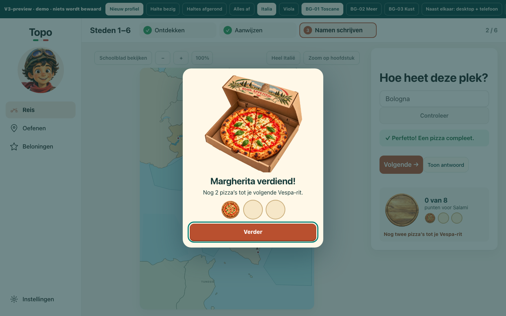
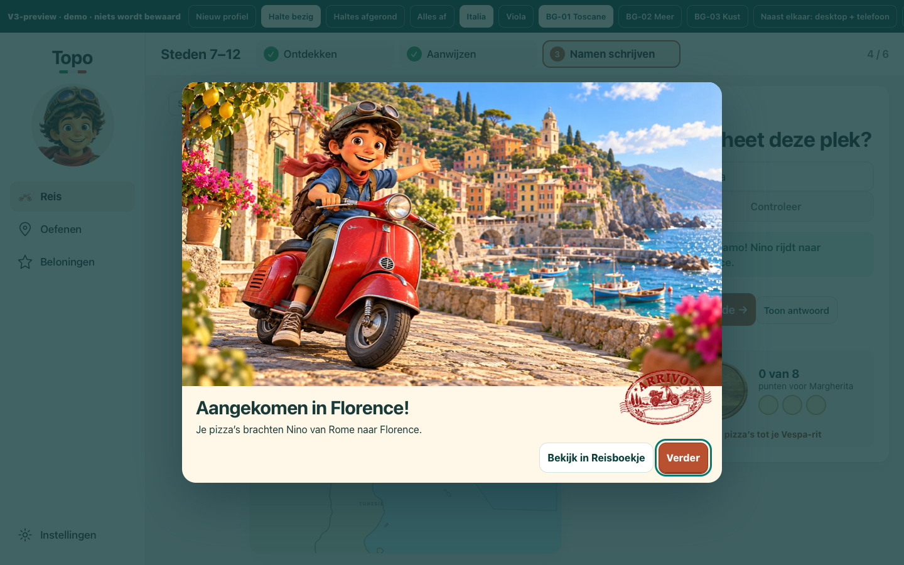
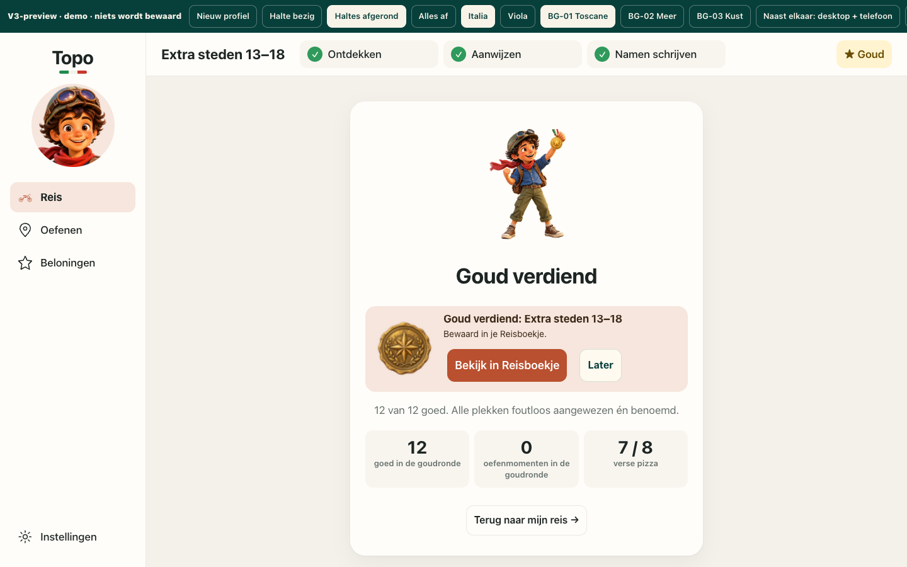
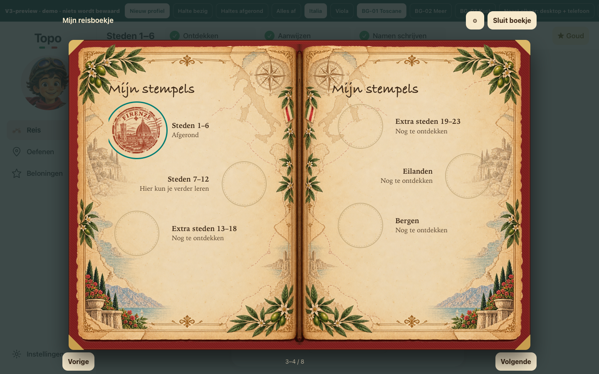

# Hermes — gerichte GE01-hertest6934799

## PASS — GE01-K01 opgelost in Chromium en WebKit

**Geteste pin:** `6934799454441582b953ed455d54ca3b0e2db722`, `codex/topo-v3`.
**Zelf gebouwde preview:**50.200.591 bytes; SHA256 **`71c2f49bf65ae04e9a1908bd7661cf8889562c0af4b3f582fd9cacfdfc4131d4`**.
**V2 index.html:** ongewijzigd, SHA256 **`3aced3c31259011b0af2947c78f71965cb4beb2e88c69d1663e61792b0304f5a`**.

Opdracht: alleen GE01 beat3–7 en de Enter-reparatie uit [vorige REWORK](https://github.com/dennisariens/topo/issues/76#issuecomment-6748173505). Geen nieuwe brede Reis-, kaart-, reliëf-, artwork- of prestatietest. Native Safari/iPad en VoiceOver blijven eigenaarstests.

| Controle | Chromium156.0.8078.4 | WebKit27.2 |
|---|---|---|
| Oorspronkelijke #nieuw-reproductie, achtste antwoord met Enter |**PASS**|**PASS**|
| Enter en Controleer, normale én verminderde beweging |**PASS**|**PASS**|
| Nieuwe bewuste Enter/Space na het beloningsmoment |**PASS**|**PASS**|
| Space op kaartdoel; ingedrukt/geherhaald Enter |**PASS**|**PASS**|
| Pizza, Vespa, stempel en goud blijven na de openingsgesture staan |**PASS**|**PASS**|
| Echte volledige les: feedback, afronden, verdiend stempel, V2-boek |**PASS**|**PASS**|
| Hervatten: vraag, modus, concept en backward-selectie |**PASS**|**PASS**|
| Replay/boek/terugweg zonder extra valuta |**PASS**|**PASS**|

**Bewijsomvang:**24/24 maintained keyboard/rewardscenario's,14/14 eigen aanvullende toetsencontroles en2 volledige onafhankelijke lesrondes. Dit zijn38 keyboardcases plus2 complete lesflows, niet een nieuwe volledige-app-acceptatie. [Machineoverzicht](SUMMARY.json).

## 1. Herhaling van de oorspronkelijke fout

Eigen driver speelt vanaf **`#nieuw`** (nul bestaande voortgang):6 Ontdekken-plekken,6 correcte Aanwijzen-antwoorden,1 correcte schrijfvraag, daarna het achtste beloonbare antwoord met **Enter** of **Controleer**.

**Nu:** de pizzadialoog blijft open. Het antwoord telt eenmaal; er ontstaat1 pizza/0 stukjes, geen extra rit. Focus zit in de beloningsdialoog. Na loslaten werkt een **nieuwe bewuste Enter of Space** wél; die sluit de eerste/tweede pizzadoos zonder extra valuta of extra correct antwoord. Met normale en verminderde beweging, beide engines.

Aanvullend:
- **Space op een echt kaartdoel:** baseline `#bezig` is expliciet een fixture (1 pizza+6 stukjes). De volgende2 correcte kaartantwoorden worden echt gespeeld; Space op het tweede veroorzaakt geen onbedoeld overslaan van de tweede pizza.
- **Ingedrukt/geherhaald Enter:** na keydown en een herhaalde keydown blijft het beloningsmoment open, ook vóór keyup. Na keyup blijft het staan; een nieuwe Enter werkt vervolgens normaal.

Alle14 eigen gevallen controleren correcte tellerdelta, open dialog, echte focus, werkende nieuwe vervolgactie, gelijke valuta/goedteller na die vervolgactie,0 page-errors en0 externe apprequests. Geen `grade()` of beloningstoestand geïnjecteerd. [Eigen driver](parent-repro.py) · [resultaten met events](parent-repro/results.json) · [definitief log](parent-repro.log).

Dit zijn nieuwe beelden op de nieuwe gehashte pin, geen hergebruikte screenshots van1a42590. De oorspronkelijke fout/positieve muisklikcontrole uit1a42590 is al onafhankelijk bewezen in het vorige rapport; dat historische resultaat is niet herschreven.

## 2. Maintained regressie onafhankelijk opnieuw uitgevoerd —24/24 PASS

`scripts/qa-v3-toets-beloning.py` opnieuw uitgevoerd, niet alleen de bouwerresultaten gelezen. Per engine12 oorspronkelijke combinaties:

- Scenario `pizza-hermes`: oorspronkelijke route vanaf nul.
- Scenario `bezig`: echte vervolgaanwijzing/-schrijven vanaf fixturebasis; pizza1→2 en2→3, Vespa0→1 en nieuw city2-stempel.
- Scenario `goud`: vereiste hoofdstukken uit `#afgerond` zijn fixture; de daaropvolgende goudronde en het nieuwe city3-goud worden daadwerkelijk via UI gespeeld.
- Elk met **Enter/klik × normale/verminderde beweging**.

Per engine **0 missing,0 closedByKey,0 leaked,0 errors**. Vier onbedoelde keyboardklikken per engine terecht tegengehouden. Geen verloren beloningsmomenten, geen ongevraagd Reisboekje door de antwoordtoets.

Doelbewuste nieuwe Enter op **Verder**, **Start de Vespa-rit** en **Overslaan** werkt in de routes. De statische reduced-motion-rit gebruikt **Verder**, niet Overslaan; de oorspronkelijke tests zijn niet aangepast om een onjuiste aanvullende aggregatie-aanname te laten slagen.

| Onderdeel | Chromium | WebKit |
|---|---|---|
| Oorspronkelijke scenario's |12/12|12/12|
| Onbedoeld gesloten momenten |0|0|
| Doorgelekte acties |0|0|
| Browserfouten |0|0|
| Correct tegengehouden foreign keyboard clicks |4|4|

[Chromium resultaten](maintained-chromium/results.json) · [WebKit resultaten](maintained-webkit/results.json) · [Chromium aggregatie](maintained-chromium/aggregate.json) · [WebKit aggregatie](maintained-webkit/aggregate.json).

**Harnessintegriteit:** parent heeft de uitgevoerde scripts met de oorspronkelijke bron vergeleken. Exact één gewijzigde regel per engine: browserlaunch. Oorspronkelijke `__file__`, ROOT, argv, scenario's en assertions behouden. Geen checks verzwakt. Herkomst en hashes in [Chromium launchprovenance](maintained-chromium/launch-provenance.json) en [WebKit launchprovenance](maintained-webkit/launch-provenance.json). Het ongewijzigde WebKit-resultaat heeft nog de generieke browserlabelprefix “Chrome”; de werkelijke launch is aantoonbaar WebKit27.2.

## 3. Eigen volledige GE01-beat3–7-flow

De eerdere onafhankelijke UI-driver opnieuw gepind. Alleen de vier out-of-scope Beloningen-demoteller-sweeps zijn uit die driver gelaten; de echte les, feedback, boek, hervatten en replay zijn behouden. Geen overname van Codex-resultaten als Hermes-acceptatie.

Beide engines spelen een verse route met één fout in Aanwijzen en één in Schrijven, correcte herstelvragen, pizza en afronding. Eindstand per engine **12 goed,1 pizza+4 stukjes,0 ritten,1 nieuw stempel**. Bestaande nulvoortgang wordt niet als geïmporteerd succes gepresenteerd.

- Feedback volgt echte goede/foute UI-antwoorden; geen rechtstreeks `grade()` aanroepen.
- Reis→Ga verder en de les→Beloningen→boek→terugweg behouden dezelfde vraag/modus, **`Rome concept`**, en keyboardselectie **9–12 backward**. Niet beweerd dat de invoer automatisch focus terugkrijgt.
- Het nieuw verdiende stempel opent het bestaande V2-boek op de stempelspread.
- Werkelijk gespeelde herhaling van afgerond Aanwijzen voegt geen valuta toe; boek/heropenen/terugweg alleen-lezen.
- Bij reload wordt de preview-hashbaseline bewust hersteld. Persistente anti-replay van een werkelijk verdiende save is daarom **niet** op dit memory-only artifact aangetoond. Dit wordt niet als nieuwe appfout of persistentie-PASS verkocht.

[Eigen flowdriver](independent-ge01.py) · [Chromium-ledger](independent-chromium/ledger.json) · [WebKit-ledger](independent-webkit/ledger.json) · [parentaggregatie](parent-summary.json).

## 4. Bronintegriteit, gates en scope

Productie-runtimeverschil sinds1a42590 is uitsluitend de16-regelige keyguard in `scripts/v3/les.js`; engines, `index.html`, assets en geografie zijn ongewijzigd. QA-script/docs/bouwersbewijs zijn daarnaast aangepast in de kandidaatgeschiedenis. [Bronaudit](source-audit.json) · [runtime-diff](runtime.diff).

Zelf preview gebouwd en daarna `npm ci`, `npm run lint`, gerichte Node-tests `nino-moments.test.mjs`/`nino-ux-round.test.mjs`, `npm run build`: **GATE_EXIT=0**. [Log](gates.log). De volledige `npm test`-straat en de vijf-formaat maintained-les-/Reis-/stijlbeeldsuites zijn hier niet opnieuw uitgevoerd; deze opdracht is de gerichte GE01-hertest.

Eerste parentprobe had een Python-harnessfout (`Request.url` als methode i.p.v. property); gecorrigeerd en de volledige14-case matrix opnieuw gedraaid. Geen appwijziging of app-REWORK daaruit afgeleid. Definitieve runs en logs zijn meegeleverd; die oude driverpoging is niet als eindbewijs gebruikt.

## Afsluiting

**GE01-K01: opgelost op exact6934799. Gerichte GE01-hertest: PASS in beide engines.** Geen tweede implementatie, wijziging aan kandidaat of brede transfer van eerdere V3-PASS naar ongeteste onderdelen.

**Echte iPad Safari en VoiceOver: NIET GETEST — eigenaar.** Geen fysieke-device-, OS-IME-, performance- of persistente-save-acceptatie geclaimd.

Bewijs op `qa/v3-ge01-6934799`, uitsluitend onder deze directory. Kandidaat en assets blijven ongewijzigd; geen merge, deployment of downloadvervanging. Volgende stap is het expliciete eigenaar-/integratiebesluit, niet een automatische releaseactie.
