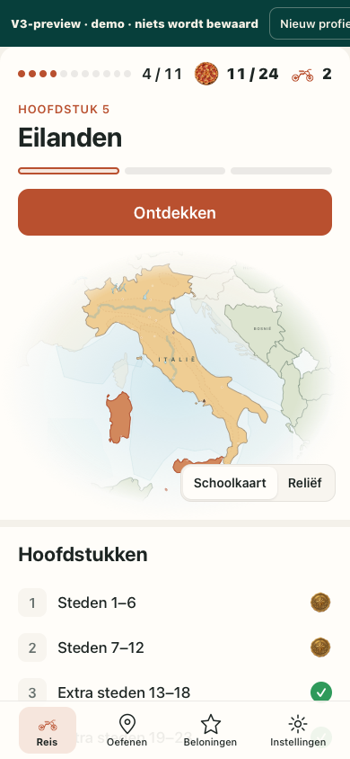

# Onafhankelijke Hermes-QA — TOPO V3 Reis v3b

## REWORK op de exact gevraagde kandidaat

**Getest:** `afb32d17293a4705c5690e985d8cd2ef7c2e6ae7` (`afb32d1`). Bouwer: Claude; deze uitvoering is onafhankelijke Hermes-QA, niet een heretikettering van de aangeleverde bouwerresultaten.

**Let op nieuwere branch-head:** bij aanvang was afb32d1 de actuele `codex/topo-v3`-head. Tijdens de QA verschoof die naar `3dbcd1345b360e9f7c9f4e16e8e821ead5550319`: `4b2c323` wijzigt kaartkader, fade, zee en positie van de stijlkeuze; `3dbcd13` voegt de GE01-specificatie toe. De diff is geïnspecteerd ([bronvergelijking](independent/newer-head-inspection.diff)), maar die nieuwere uitvoering is **niet getest**. Dit oordeel en alle reproducties gelden voor afb32d1, niet automatisch voor de nieuwe head. Er is niet uitgecheckt, gerebased of geïmplementeerd op de bouwersbranch.

## Oordeel per gevraagde punt

| Punt | Oordeel | Kort bewijs |
|---|---|---|
| Reproduceerbaarheid en V2-behoud | **PASS** | Preview exact verwachte SHA; V2-index exact ongewijzigd; lint/test/build exit0; oorspronkelijke QA ook in WebKit uitgevoerd. |
| 1. Voortgang, alle hoofdstukacties, Reis → Ga verder | **PASS** |224 fixturematrixgevallen; per engine24 echte correcte antwoorden plus6 ontdekstappen; eerste hoofdstuk werkelijk goud; vraag/concept/selectie behouden. |
| 2. Kaartkopie, highlights, namen, focus/AX, reliëf | **REWORK** | Bronpaden/centra/transforms en highlights exact; geen focus/AX-duplicaten; reliëf werkt. Maar vaste contextnamen blijven zichtbaar, in strijd met letterlijk 'geen namen' (V3-01). |
| 3. Rome/Vaticaan, San Marino, eilanden, Apennijnen | **REWORK** voor volledige zichtbaarheid | Geen bronpositie verplaatst. Sicilië wordt op telefoon door de kaartstijlknoppen bedekt (V3-02). Rome/Vaticaan liggen op overzichtsschaal nagenoeg samen; geen onterechte claim van twee afzonderlijk herkenbare markers. |
| 4. Zes formaten, vouw, woordbreuk, afkapping, overlap | **REWORK** |60 controles van shell/defaultstanden/lange titel slagen. Tabbar laat laatste rij vrij bij volledig scrollen. De aparte kaartocclusiecontrole toont wel V3-02. Alleen button-button-overlap meten is dus onvoldoende. |
| 5. Toetsenbord/focus, reduced motion, offline, opslag | **REWORK** | Geen requests/fouten, echte opslagcanaries onveranderd, focusring3px waar focus staat. Op telefoon verdwijnt focus naar BODY na hoofdstukkeuze (V3-03). |
| 6. Anti-patronen en pedagogiek | **PASS voor de richting, met risico's** | Actueel hoofdstuk, status, drie lessen en één actie zijn leesbaar; geen nieuwe art/geografie. Bekende frame/fade-risico's blijven eigenaarwerk, niet als nieuwe fout geteld. |

**NIET GETEST:** echte iPad Safari en VoiceOver (blijven eigenaarstests), native Safari, echte touch/OS-toetsenbord/IME. WebKit is geen native Safari- of hardwaregoedkeuring. Geen merge/deployment/releasepublicatie/downloadvervanging.

## Nieuwe bevindingen — kortste reproductie en impact

### V3-01 — vaste kaartnamen blijven in de naamloze kloon

**REWORK, begrensde contractafwijking.** Open de checksum-gecontroleerde preview op afb32d1, bijvoorbeeld `#afgerond` bij820×1180. De kaart toont o.a. **I T A L I Ë**, **DUITSLAND**, **TSJECHIË** en **BOSNIË**. In beide engines staan zeven vaste naamteksten in `.mapLabel/.contextLabel`; alleen de dynamische `nameLayer` en `.nameLabel` zijn verwijderd.

Dit zijn **contextnamen, geen namen van de45 leerdoelen**. Er is dus geen bewezen nieuw antwoordlek; wel wijkt de kandidaat af van de expliciete eis 'geen namen'. Geen nieuwe geografische bron of verzonnen locatie.

[Eigen DOM-meting](independent/names-and-webkit-keyboard.json) · [Chromium-beeld](independent/chromium-map-visible-names.png) · [WebKit-beeld](independent/webkit-map-visible-names.png).

### V3-02 — kaartstijlbediening bedekt geselecteerd Sicilië

**REWORK.** Open `#afgerond` op390×844: **Eilanden** is geselecteerd en ontgrendeld, hoofdactie **Ontdekken**. De Schoolkaart/Reliëf-bediening staat over Sicilië. Ook in een handmatig gekozen/gesloten eilandenhoofdstuk is dezelfde occlusie gereproduceerd.

Eigen parentprobe: het onderzochte middelpunt ligt daadwerkelijk **in de gevulde Siciliaanse polygon**, én binnen de bedieningsrechthoek. Overlap met de eiland-boundingrect: Chromium1486.63CSSpx²; WebKit1486.15CSSpx². De foto's bevestigen daadwerkelijk afgedekte geografie, niet alleen lege rechthoeken. Sicilië zelf is niet verplaatst.

**Impact:** de leerling ziet een deel van het centrale geselecteerde eiland niet. Dit is een concrete bediening/kaart-overlap, **niet** het reeds bekende verzoek om ruimer kader/minder fade.

[Eigen meetdata incl. isPointInFill](independent/storage-and-occlusion.json) · [Chromium](independent/chromium-unlocked-islands-occlusion.png) · [aanvullende contextmetingen](map/context-results.json).

### V3-03 — hoofdstukselectie met toetsenbord verliest focus op telefoon

**REWORK; geen volledige keyboardtrap.** Open `#alles` op390×844. Bereik Steden7–12 met echte Tab-stappen en druk Enter. Bij Chromium is na de selectie `activeElement===document.body`; de focusring verdwijnt. De eerstvolgende Tab gaat naar Schoolkaart. Bij WebKit via macOS **Option-Tab** eveneens BODY; de volgende focusstap springt terug naar Steden1–6.

**Impact:** selectie verplaatst het scherm, maar geen focus gaat mee naar de nieuwe inhoud en de geselecteerde rij verliest zijn focus. De leerling verliest zijn toetsenbordpositie; acties zijn later nog bereikbaar. Desktop behoudt wel de verbonden rij en de3px-ring.

[Eigen exacte key/focusmetingen](independent/phone-focus.json) · [Chromium na Enter](independent/chromium-phone-enter-focus.png) · [WebKit na Enter](independent/webkit-phone-enter-focus.png).

WebKit tabt in deze hostconfiguratie standaard niet naar knoppen. Daarom aanvullend Option-Tab gebruikt, zonder OS-instellingen te wijzigen. Het bestaande script doet `pg.focus()` voor zijn Enter-test en ziet dit probleem daardoor niet. Die scriptuitkomst is geen bewijs van een geslaagde echte Tab-navigatie in WebKit.

## Build, checksums en oorspronkelijke QA

- `node scripts/build-v3-preview.mjs`: **41.476.860bytes**, SHA256 **`35a0c4696f42abe7555bcb4452540598c493812abc783412b78b9d06ac6a610d`** — exact verwacht, geen afwijking.
- `index.html`: **41.445.845bytes**, SHA256 **`3aced3c31259011b0af2947c78f71965cb4beb2e88c69d1663e61792b0304f5a`** — volledige V2.0.2-hash exact, niet alleen de prefix.
- `npm ci`, daarna **`npm run lint && npm test && npm run build`** werkelijk uitgevoerd op de pin. Volledige herstart exit0, zonder checks te verzwakken. De eerste180s-run is als omgevingslimiet afgebroken; de volledige run nam langer en is daarna apart tot exit0 gevolgd. Vereiste historische commit `8a704cb23da97baf7197635df7fa12f06b864a24` opgehaald vóór de tests.
- Python3.11 en Playwright1.64.0 in eigen tooling; oorspronkelijke `qa-v3-reis.py` zonder bronwijziging op Chromium156.0.8078.4 uitgevoerd. Voor WebKit27.2 uitsluitend de launch-regel vervangen in een externe runner; alle checks/afmetingen/flows gelijk. Originele/adapted SHA en exacte éénregel-diff staan in [provenance](maintained-webkit/provenance.json). Het geërfde JSON-label 'Chrome27.2' is een hardcoded scriptnaam, **werkelijke engine is WebKit**.
- Beide oorspronkelijke suites:20 layoutgevallen, geen gerapporteerde overlap/clipping/woordbreuk/overflow/verborgen laatste rij, hoofdactie boven de vouw, flows inclusief replay/resume geslaagd. Dit is eigen heruitvoering van bouwerscript, niet blind overgenomen bewijs. De onafhankelijke probes zijn aanvullend en bepalend.

[Setup/build](independent/setup-build.log) · [volledige gate-log](independent/gates-complete.log) · [geverifieerde gates](independent/verified-gates.json) · [Chromium-resultaten](maintained-chromium/results.json) · [WebKit-resultaten](maintained-webkit/results.json).

## Eigen matrix, echt spel en integriteit

### Voortgang en lesacties

Alle11 hoofdstukken × vier ingebouwde demostanden, beide engines: per engine44 statusgevallen plus68 beschikbare acties. Alle224 gevallen opnieuw uit de ruwe records geteld en geslaagd. Sloten hebben geen startactie. ✓/goud/slot/lesstaaf en labels komen overeen met de canonieke toestand; elke geklikte hoofd-/herhaalactie start juist hoofdstuk en soort, incl. review/goud.

**Fixtures:** deze matrix begint expliciet met `#nieuw/#bezig/#afgerond/#alles`-demo's; geen claim dat hun voorgeschiedenis is uitgespeeld.

**Echt gespeeld vanaf #nieuw:** per engine6 ontdekstappen,6 correcte pointer-toetsenbordactivaties,6 correcte schrijf-antwoorden,12 correcte goud-antwoorden incl. echte rondepauze. Resultaat: hoofdstuk1 echt goud, hoofdstuk2 open, één rit. Geen aanroep van `grade`/`TopoRoute.answer`/`startRouteLesson` en geen mutatie van de appstaat. Concept **Florxyzence**, selectie2–7/backward blijven bij Reis → Ga verder gelijk; selectie is via native input-API ingesteld, daarna echte navigatieknoppen.

[224 matrixrecords](flows/matrix.json) · [60 echte-spel/progressierecords](flows/gameplay.json) · [getelde samenvatting](flows/summary.json) · [Chromium goud](flows/chromium-real-gold-home.png) · [WebKit schrijfselectie hersteld](flows/webkit-real-writing-restored.png).

### Kaart en landmarks

Eigen132-cellenmatrix:11 hoofdstukken × twee stijlen × drie formaten × twee engines.131 geometrie-/transformrecords blijven gelijk aan de live bronkaart; op alle132 cellen juiste unieke highlightsets.46 DOM-data-id-elementen vertegenwoordigen45 items; San Marino heeft een extra hitcirkel. Geen tweede leeritem door die dubbeling. ID-prefixing, echte fragmentreferenties en geen dubbele DOM-IDs bevestigd; twee aanvankelijke hexkleur-valspositieven uit de ruwe refcheck zijn in de gerichte contextcontrole uitgesloten.

Decoratieve SVG is aria-hidden/focusable-false en heeft nul focusstops/benoemde descendants in alle matrixcellen. Dit bewijst geen echte VoiceOver-conformiteit. Reliëf wordt daadwerkelijk zichtbaar en weer verborgen zonder highlights/broncoördinaten te wijzigen.

Radius8/3 en zichtbare selectie van de extra San-Marino-hitcirkel zijn presentatie-/symbolisatieverschillen, geen verplaatsing van canonieke ankers. Niet als uitgevonden geografie of nieuwe hoofdblokker gepresenteerd. Rome/Vaticaan behouden hun nabijgelegen echte ankers, maar zijn in een uitgezoomd overzicht niet als twee afzonderlijke stippen te herkennen. San Marino en Apennijnen blijven canoniek; geen nieuwe GIS-validatie of grensnauwkeurigheid geclaimd.

[Kaartmatrix](map/matrix.json) · [context/geometrie](map/context-results.json) · [kaartdeelreview met begrensde observaties](map/REPORT.md).

### Layout, opslag en reduced motion

Zes formaten:1440×900,1280×800 (hoogte expliciet gekozen waar alleen breedte was opgegeven),1180×820,820×1180,390×844,320×568. Vier demostanden plus per formaat de lange titel Extra steden13–18, beide engines: **60 layoutgevallen**. Geen afkapping/woordbreuk/horizontale overflow of control-control-overlap; acties boven de vouw, laatste rij volledig boven de tabbar scrollbaar. V3-02 valt buiten een alleen-op-controls gerichte botsingsmeting en is daarom apart gemeten.

Hashwissels laden de preview opnieuw. De eerste eigen scan mat WebKit-scroll vóór uitlopen van smooth scroll; geen productfout. Volledige hermeting wacht op de juiste demostand en gebruikt expliciete instant camerasprongen voor begin/eind-scrollmeting. De60 layoutrecords zijn compleet. Een latere hashwissel in diezelfde uitgebreide runner verloor zijn execution context tijdens opslagdiagnostiek; daarom de opslagacceptatie nogmaals volledig in10 onafhankelijke verse contexts uitgevoerd, niet uit onvolledige velden afgeleid.

Die definitieve canarytest (vier standen+Viola per engine) bewaakt de **werkelijke native Storage achter de memory-facade**: nul reads/writes/removes/clears door de kandidaat, exacte native bytes behouden na hoofdstuk- en reliëfkeuzes. Offline file:// met netwerk uit; nul gemeten externe page-requests en JS/consolefouten.

Reduced motion: knopovergangen en ruimtelijke/decoratieve beweging uit, functionele feedback zichtbaar. Zeven geërfde landpaden hebben nog een150ms **fill-kleurtransitie** bij highlightwissel; geen ruimtelijke beweging. Dit is nauwkeuriger dan de absolute README-claim 'geen overgangen'; niet als afzonderlijke blocker geteld onder de toegestane functionele feedback.

[60 layoutmetingen en keyboardscan](parent/results.json) · [definitieve10 native-opslagmetingen](independent/storage-and-occlusion.json) · [reduced-motiondetail](independent/reduced-detail.json).

## Anti-patronen, pedagogiek en bekend eigenaarsbesluit

- **Too much — PASS:** geen nieuwe slogan-/uitlegpanelen in de app; preview-toolbar is expliciete demo-infrastructuur, niet de leerlingnavigatie.
- **Too little — PASS met risico:** huidige/selectie, voortgang en hoofdactie zijn direct leesbaar. Te weinig geografisch referentiekader bij sterke fade blijft het reeds bekende risico, geen nieuwe bug.
- **Boxed — PASS:** één samenhangende schil, geen stapel losse widgets.
- **Flat / Bland — PASS voor goedgekeurde richting:** rust en beperkte accentkleur ondersteunen keuze; reliëf biedt context. Geen heropening van de eigenaar-goedgekeurde v3b-richting om smaakredenen.
- **Off-model Nino — PASS:** de canonieke guide-illustratie, met CSS-portretuitsnede; geen nieuw gegenereerde pose of artbron.
- **Invented geography — PASS bronintegriteit:** geen verplaatste/pseudo-geografische vormen; behoud van bestaande schematische onderwijzones is geen onafhankelijke GIS-certificering.
- **Pedagogiek — PASS basis, REWORK concreet waar hierboven:** standaard juiste volgende hoofdstuk, onderscheiden klaar/goud/slot, reden bij slot en drie lesstappen helpen kiezen. Een geselecteerd eiland bedekken en na toetsenbordselectie focus verliezen verzwakken dit echter aantoonbaar.

**Bekend, niet nieuw:** eigenaar heeft v3b als richting en Italia als standaard goedgekeurd; ruimer kaartkader/minder fade was nog niet verwerkt in afb32d1. Risico: buurlanden/zee-/eilandrelaties en microcontext verdwijnen terwijl de brongeometrie wel klopt. Niet als vierde nieuwe fout geteld. De latere `4b2c323` adresseert dit in bron, maar is hier niet browsergetest.

## Vervolg en discipline

Herstel/bevestig V3-01, V3-02 en V3-03 op een nieuwe expliciet aangewezen pin; hertest daar gericht, zonder deze oude-SHA-uitslag op de nieuwere head te plakken. Echte iPad Safari en VoiceOver blijven eigenaarstest. Alleen deze bewijsdirectory op `qa/v3-reis-afb32d1`; geen wijziging aan kandidaat, `codex/topo-v3`, source-art of publieke downloads. Een samenvatting met de bewijscommit komt op issue76, zonder merge/deployment.
