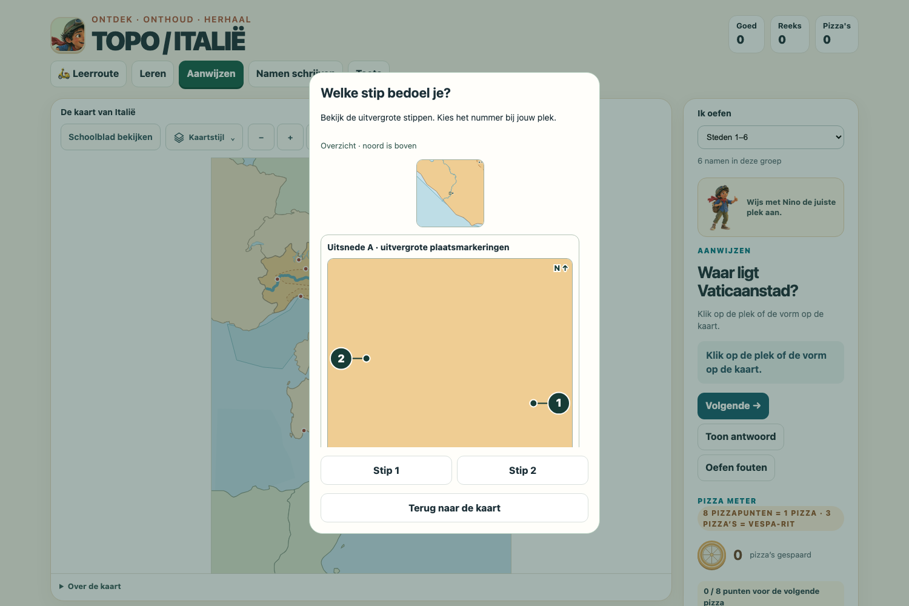
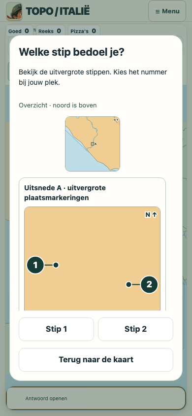

# Real runtime screenshot review — issue #58

Baseline SHA: `bd1e57bc48e55a065cbbccb68acea196a64a187c`. All images are actual Chromium file:// runtime screenshots with networking disabled. Matrix fixtures set the requested question explicitly; no generated diagram is used. Click an image link for original rendered pixels. Owner human GO/ADJUST and physical Safari review are pending.

| Case | Viewport | Before | After | Scrolled detail |
| --- | --- | --- | --- | --- |
| Rome/Vatican | desktop 1500×1000 | [Before](before-desktop-overview-school-area-o_city-9.png) | [After](after-desktop-overview-school-area-o_city-9.png) | [Detail](after-desktop-overview-school-area-o_city-9-detail.png) |
| Naples/Vesuvius | desktop 1500×1000 | [Before](before-desktop-overview-school-area-e_city-6.png) | [After](after-desktop-overview-school-area-e_city-6.png) | [Detail](after-desktop-overview-school-area-e_city-6-detail.png) |
| Catania/Etna | desktop 1500×1000 | [Before](before-desktop-overview-school-area-f_city-15.png) | [After](after-desktop-overview-school-area-f_city-15.png) | [Detail](after-desktop-overview-school-area-f_city-15-detail.png) |
| Bologna/Modena | desktop 1500×1000 | [Before](before-desktop-overview-school-city-2_city-20.png) | [After](after-desktop-overview-school-city-2_city-20.png) | [Detail](after-desktop-overview-school-city-2_city-20-detail.png) |
| Milan/Varese | desktop 1500×1000 | [Before](before-desktop-overview-school-city-13_city-5.png) | [After](after-desktop-overview-school-city-13_city-5.png) | [Detail](after-desktop-overview-school-city-13_city-5-detail.png) |
| San Marino surroundings | desktop 1500×1000 | [Before](before-desktop-overview-school-area-n_city-3.png) | [After](after-desktop-overview-school-area-n_city-3.png) | [Detail](after-desktop-overview-school-area-n_city-3-detail.png) |
| Sea overlap | desktop 1500×1000 | [Before](before-desktop-overview-school-water-C_water-D.png) | [After](after-desktop-overview-school-water-C_water-D.png) | [Detail](after-desktop-overview-school-water-C_water-D-detail.png) |
| Rome/Vatican | landscape 1180×820 | [Before](before-landscape-overview-school-area-o_city-9.png) | [After](after-landscape-overview-school-area-o_city-9.png) | [Detail](after-landscape-overview-school-area-o_city-9-detail.png) |
| Naples/Vesuvius | landscape 1180×820 | [Before](before-landscape-overview-school-area-e_city-6.png) | [After](after-landscape-overview-school-area-e_city-6.png) | [Detail](after-landscape-overview-school-area-e_city-6-detail.png) |
| Catania/Etna | landscape 1180×820 | [Before](before-landscape-overview-school-area-f_city-15.png) | [After](after-landscape-overview-school-area-f_city-15.png) | [Detail](after-landscape-overview-school-area-f_city-15-detail.png) |
| Bologna/Modena | landscape 1180×820 | [Before](before-landscape-overview-school-city-2_city-20.png) | [After](after-landscape-overview-school-city-2_city-20.png) | [Detail](after-landscape-overview-school-city-2_city-20-detail.png) |
| Milan/Varese | landscape 1180×820 | [Before](before-landscape-overview-school-city-13_city-5.png) | [After](after-landscape-overview-school-city-13_city-5.png) | [Detail](after-landscape-overview-school-city-13_city-5-detail.png) |
| San Marino surroundings | landscape 1180×820 | [Before](before-landscape-overview-school-area-n_city-3.png) | [After](after-landscape-overview-school-area-n_city-3.png) | [Detail](after-landscape-overview-school-area-n_city-3-detail.png) |
| Sea overlap | landscape 1180×820 | [Before](before-landscape-overview-school-water-C_water-D.png) | [After](after-landscape-overview-school-water-C_water-D.png) | [Detail](after-landscape-overview-school-water-C_water-D-detail.png) |
| Rome/Vatican | portrait 820×1180 | [Before](before-portrait-overview-school-area-o_city-9.png) | [After](after-portrait-overview-school-area-o_city-9.png) | [Detail](after-portrait-overview-school-area-o_city-9-detail.png) |
| Naples/Vesuvius | portrait 820×1180 | [Before](before-portrait-overview-school-area-e_city-6.png) | [After](after-portrait-overview-school-area-e_city-6.png) | [Detail](after-portrait-overview-school-area-e_city-6-detail.png) |
| Catania/Etna | portrait 820×1180 | [Before](before-portrait-overview-school-area-f_city-15.png) | [After](after-portrait-overview-school-area-f_city-15.png) | [Detail](after-portrait-overview-school-area-f_city-15-detail.png) |
| Bologna/Modena | portrait 820×1180 | [Before](before-portrait-overview-school-city-2_city-20.png) | [After](after-portrait-overview-school-city-2_city-20.png) | [Detail](after-portrait-overview-school-city-2_city-20-detail.png) |
| Milan/Varese | portrait 820×1180 | [Before](before-portrait-overview-school-city-13_city-5.png) | [After](after-portrait-overview-school-city-13_city-5.png) | [Detail](after-portrait-overview-school-city-13_city-5-detail.png) |
| Sea overlap | portrait 820×1180 | [Before](before-portrait-overview-school-water-C_water-D.png) | [After](after-portrait-overview-school-water-C_water-D.png) | [Detail](after-portrait-overview-school-water-C_water-D-detail.png) |
| Rome/Vatican | phone 390×844 | [Before](before-phone-overview-school-area-o_city-9.png) | [After](after-phone-overview-school-area-o_city-9.png) | [Detail](after-phone-overview-school-area-o_city-9-detail.png) |
| Naples/Vesuvius | phone 390×844 | [Before](before-phone-overview-school-area-e_city-6.png) | [After](after-phone-overview-school-area-e_city-6.png) | [Detail](after-phone-overview-school-area-e_city-6-detail.png) |
| Catania/Etna | phone 390×844 | [Before](before-phone-overview-school-area-f_city-15.png) | [After](after-phone-overview-school-area-f_city-15.png) | [Detail](after-phone-overview-school-area-f_city-15-detail.png) |
| Bologna/Modena | phone 390×844 | [Before](before-phone-overview-school-city-2_city-20.png) | [After](after-phone-overview-school-city-2_city-20.png) | [Detail](after-phone-overview-school-city-2_city-20-detail.png) |
| Milan/Varese | phone 390×844 | [Before](before-phone-overview-school-city-13_city-5.png) | [After](after-phone-overview-school-city-13_city-5.png) | [Detail](after-phone-overview-school-city-13_city-5-detail.png) |
| San Marino surroundings | phone 390×844 | [Before](before-phone-overview-school-area-n_city-3.png) | [After](after-phone-overview-school-area-n_city-3.png) | [Detail](after-phone-overview-school-area-n_city-3-detail.png) |
| Sea overlap | phone 390×844 | [Before](before-phone-overview-school-water-C_water-D.png) | [After](after-phone-overview-school-water-C_water-D.png) | [Detail](after-phone-overview-school-water-C_water-D-detail.png) |
| Rome/Vatican | small-phone 320×568 | [Before](before-small-phone-overview-school-area-o_city-9.png) | [After](after-small-phone-overview-school-area-o_city-9.png) | [Detail](after-small-phone-overview-school-area-o_city-9-detail.png) |
| Naples/Vesuvius | small-phone 320×568 | [Before](before-small-phone-overview-school-area-e_city-6.png) | [After](after-small-phone-overview-school-area-e_city-6.png) | [Detail](after-small-phone-overview-school-area-e_city-6-detail.png) |
| Catania/Etna | small-phone 320×568 | [Before](before-small-phone-overview-school-area-f_city-15.png) | [After](after-small-phone-overview-school-area-f_city-15.png) | [Detail](after-small-phone-overview-school-area-f_city-15-detail.png) |
| Bologna/Modena | small-phone 320×568 | [Before](before-small-phone-overview-school-city-12_city-2_city-20.png) | [After](after-small-phone-overview-school-city-12_city-2_city-20.png) | [Detail](after-small-phone-overview-school-city-12_city-2_city-20-detail.png) |
| Milan/Varese | small-phone 320×568 | [Before](before-small-phone-overview-school-city-13_city-5.png) | [After](after-small-phone-overview-school-city-13_city-5.png) | [Detail](after-small-phone-overview-school-city-13_city-5-detail.png) |
| San Marino surroundings | small-phone 320×568 | [Before](before-small-phone-overview-school-area-n_city-3.png) | [After](after-small-phone-overview-school-area-n_city-3.png) | [Detail](after-small-phone-overview-school-area-n_city-3-detail.png) |
| Sea overlap | small-phone 320×568 | [Before](before-small-phone-overview-school-water-C_water-D.png) | [After](after-small-phone-overview-school-water-C_water-D.png) | [Detail](after-small-phone-overview-school-water-C_water-D-detail.png) |

## Rome/Vatican, desktop

## Rome/Vatican, phone

Raw per-tap evidence: [collision-results.json](collision-results.json), [session-results.json](session-results.json), [same-tap-results.json](same-tap-results.json), [occluded-layout-results.json](occluded-layout-results.json), [summary.json](summary.json). Country-border-only sets and Focus-occluded cells are distinguished from physical tap passes.
